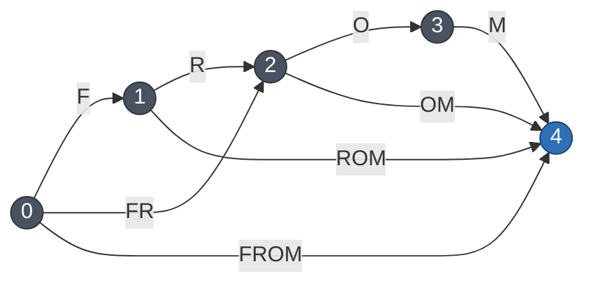
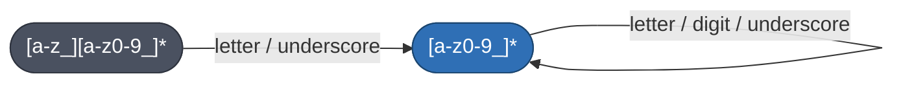
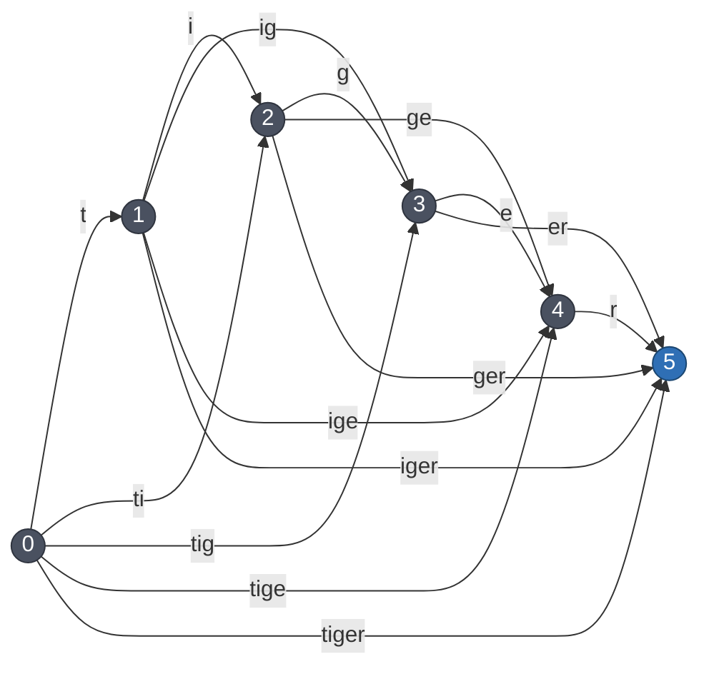

# oraculum

An SQL autocomplete framework which guarantees grammatical and semantical correctness in the following subset of the language.

```xml
<statement>   := [WITH [RECURSIVE] <definition> [, <definition>]*] <query> ;
<definition>  := <name> [( <name> [, <name>]* )] AS ( <query> )

<query>       := <member> [<set operator> <member>]*
                 [ORDER BY <sort key> [, <sort key>]*] [LIMIT <count> [OFFSET <count>]]
<member>      := SELECT [DISTINCT] <items> FROM <entry> [, <entry>]*
                 [WHERE <filters>] [GROUP BY <keys> [HAVING <filters>]]
<set operator>:= UNION | UNION ALL | INTERSECT | EXCEPT

<items>       := <item> [, <item>]*
<item>        := <value> [AS <name>]
<value>       := <term> [(+ | - | * | /) <term>]*
<term>        := <field ref> | <literal> | <call> | <aggregate> | <ranking> | <case> | <subquery>
<call>        := <scalar>(<value> [, <value>]*) | CAST(<value> AS TEXT)
<scalar>      := ABS | COALESCE | LENGTH | LOWER | ROUND | TRIM | UPPER
<aggregate>   := COUNT(*) | <function>([DISTINCT] <value>) [<window>]
<function>    := COUNT | SUM | AVG | MIN | MAX
<ranking>     := (ROW_NUMBER | RANK | DENSE_RANK)() <window>
<window>      := OVER ([PARTITION BY <field ref> [, ...]] [ORDER BY <field ref> [ASC | DESC] [, ...]])
<case>        := CASE [WHEN <value> (<operator> <value> | IS [NOT] NULL) THEN <value>]+
                 [ELSE <value>] END
<field ref>   := <field> | <alias>.<field>

<entry>       := <source> [<join>]* | <subquery> AS <alias>
<join>        := <join type> <source> ON <column ref> = <column ref>
<source>      := <table> [AS <alias>]
<join type>   := INNER JOIN | LEFT JOIN | RIGHT JOIN | FULL JOIN

<keys>        := <operand> [, <operand>]*
<sort key>    := (<output name> | <operand> | <aggregate>) [ASC | DESC]
<filters>     := <predicate> [(AND | OR) <predicate>]*
<predicate>   := [NOT] (<condition> | "(" <filters> ")")
<condition>   := <operand> <operator> <operand | literal | subquery>
               | <operand> [NOT] BETWEEN <operand | literal> AND <operand | literal>
               | <operand> [NOT] IN (<literal> [, <literal>]* | <query>)
               | <operand> IS [NOT] NULL
               | EXISTS <subquery>
<subquery>    := ( <query> )
<operand>     := <column> | <qualifier>.<column> | <scalar>(<operand>)
               | <aggregate>                                (in HAVING and ORDER BY)
```

## Setup

Needs [Rust](https://rustup.rs), [UV](https://docs.astral.sh/uv/getting-started/installation)
and Python 3.14. Everything else is downloaded at a version this repository
names.

Each project builds itself, from its own directory:

```bash
cd seer
make build       # seer and the kernel, natively
make test        # the corpus, one character at a time, then run in SQLite
make fuzz        # random walks through the graph, checked and run in SQLite
make postgres    # the corpus and the walks, run in PostgreSQL
make run         # interactive: the graph offers tokens, you pick one
make live        # the same, with a model doing the picking
make wasm        # the same kernel, cross compiled to WebAssembly
```

```bash
cd kernel
make build       # the kernel alone, into its own venv
make benchmark   # DFA layouts, timed
```

```bash
make docs        # the browser build, into docs/
```

## Acknowledgement

The foundational experiments, designing the architectural layers of grammatical and semantic rulesets, were carried out with the blood and sweat of old-fashioned human work. For the later stages, Anthropic's `Claude Opus 4.6 - 5.5` and Google's `Gemini 3.1 Pro` large language models were heavily used to port code between Python and Rust, introduce new targets and extend the supported subset of SQL. While these models are excellent tools, caution is mandatory, as they can get entangled over time if their generated spaghetti code is not tamed.

## Introduction

Imagine a text box where you type SQL and the system only ever offers you tokens that lead to a valid, answerable query. You write `SELECT em` and it completes `email` but not `body` if the table you are heading towards does not have a `body`. You have not typed `FROM` yet but the system already knows which tables are still possible. When you do get to `FROM`, only the tables that can actually answer your projection show up, the `ON` clause of a join writes itself from the foreign keys and the `WHERE` clause only offers operators that make sense for the column's type. Every token the model produces is guaranteed correct, grammatically and semantically, without any post validation.

### WASM based demo

<p align="center">
  <a href="https://pinting.github.io/oraculum/">
    
    Click here the open the demo.
  </a>
</p>

### Atoms

**Token trees:** A language model writes in tokens, fixed pieces drawn from a vocabulary of hundreds of thousands of entries, each covering one or more characters. The same keyword can arrive as one piece or many and every way of spelling it forms a path through a graph over the character positions in the string:



Each edge is a vocabulary token whose text covers exactly those positions. A path from 0 to 4 is one valid tokenisation of `FROM`. To enforce grammar at the token level every grammatical element (a keyword, an identifier pattern, a literal format) has to become an automaton that accepts exactly the token sequences spelling it.

**Constants and patterns as automata:** A fixed keyword like `FROM` is the position graph above, already a DFA over tokens: acyclic, one accepting state, found by a single Aho-Corasick sweep of the vocabulary. A regular expression cannot be drawn as positions. Instead the states are the **derivatives** of the regex: strip one character and see what regex is left. The identifier pattern `[a-z_][a-z0-9_]*` has exactly two live states:



The first character class is consumed and the starred tail loops on itself. Two derivatives, two states. Transitions on vocabulary tokens walk all characters at once, pruned by a trie so that dead prefixes skip whole subtrees.

**The grammar as an NFA:** Wire the keyword constants and identifier patterns as edges in a graph whose shape is the SQL grammar. Every edge label is one of the automata from the previous step: a constant, a pattern or a difference of patterns. Walking an edge means feeding tokens into that automaton until it accepts, then following the grammar arc. Multiple edges out of one node are multiple live branches, which makes the graph an NFA. The system determinises lazily, one token at a time, rather than building the exponential product machine up front.

**Latent state, enabling and disabling routes:** The grammar graph is static: it knows that *a* field follows `SELECT` and *a* table follows `FROM`, but not which ones. A second layer, the latent state, rides alongside the walk and enables or disables edges as the query grows.

The latent state holds what the query has committed to so far. Each branch of the walk has its own copy, so one branch never sees the choices of another. An edge is offered only if the query can still be completed after taking it.

What the state tracks depends on the clause. In the projection it works out which tables could still supply the fields selected so far and withdraws any field that would contradict the selection. In the FROM clause it offers only the tables the projection needs and a join only reaches a table linked to the entry by a foreign key, which also fills in the `ON` clause. Once the FROM clause is finished its columns form a fixed table and the rest of the query is written against it: a condition may name only those columns and the type of a column decides which operators and literals can follow it. Grouping, sorting, `WITH` definitions and subqueries are tracked the same way. The terminator is not offered until the FROM clause supplies every table the projection needs. Section 6 covers how each of these is computed.

### An example

With that machinery in place, here is how a concrete query unfolds over a real schema.

```sql
CREATE TABLE users (
    id BIGINT PRIMARY KEY,
    first_name VARCHAR(255) NOT NULL,
    last_name VARCHAR(255) NOT NULL,
    email VARCHAR(255) UNIQUE NOT NULL,
    verified BOOLEAN,
    created_at TIMESTAMP
);

CREATE TABLE posts (
    id BIGINT PRIMARY KEY,
    user_id BIGINT NOT NULL REFERENCES users(id),
    title VARCHAR(255) NOT NULL,
    body TEXT NOT NULL,
    published_at TIMESTAMP
);

CREATE TABLE comments (
    id BIGINT PRIMARY KEY,
    user_id BIGINT NOT NULL REFERENCES users(id),
    post_id BIGINT NOT NULL REFERENCES posts(id),
    body TEXT NOT NULL
);
```

**The projection:** One or more columns, each written root or scoped by an
alias. An alias is invented by whoever is generating, since nothing in the
schema names it, so it may be any identifier that no keyword, table or column
already spells: `users2` is available, `users` is taken. Aliases are
introduced here and nowhere else: `FROM users AS u` is reachable only once
something has written `u.` in the projection.

```sql
SELECT email, first_name FROM users;
SELECT u.email, u.first_name FROM users AS u;
```

What may be written is what the schema can still answer. `email` is on `users`
alone, so writing it settles which table the clause needs. `body` is on `posts`
and `comments`, so it leaves both open until something else decides between
them. A name drops out once nothing that could supply it is left: after
`SELECT id, title` the root `id` has to come from exactly one source and
`title` has pinned that source to `posts`, so `users` is out and `first_name`
is no longer offered. Section 6.1 is how that is computed.

**The FROM clause:** One or more entries, comma separated, each a table
optionally renamed by `AS`. Only tables the projection actually requires are
ever offered and the statement cannot reach its terminator until every one of
them has been supplied.

```sql
SELECT email, body FROM users, comments;
```

**Joins:** Any entry may be grown by any number of joins, in all four types.
The target has to be a foreign key neighbour of the entry as it now stands and
that settles the `ON` columns outright, since they are read off the foreign
key.

```sql
SELECT email, title FROM users INNER JOIN posts ON users.id = posts.user_id;
SELECT email, title FROM users FULL JOIN posts ON users.id = posts.user_id;
SELECT title, c.body FROM posts LEFT JOIN comments AS c ON posts.id = c.post_id;
```

Joining merges the two, so a table two foreign keys away becomes reachable once
the table between them is in. The second join here is only offered because the
first one brought `posts` into the entry:

```sql
SELECT email, title, c.body
FROM users
INNER JOIN posts ON users.id = posts.user_id
INNER JOIN comments AS c ON posts.id = c.post_id;
```

A renamed source answers to its alias everywhere afterwards and to nothing
else, so `FROM users AS u` makes the join `ON u.id = posts.user_id`, never
`ON users.id`. Section 6.3 is the graph this walks.

**The WHERE clause:** Optional and written against the relation the FROM
clause produced: every column of every source it placed, joined or not.
Each is reachable scoped by its source's alias or table name and root
wherever exactly one source supplies the name. A column does not have to be
projected to be filtered on.

```sql
SELECT email FROM users WHERE created_at IS NOT NULL;
SELECT email FROM users WHERE first_name LIKE 'A%';

SELECT email, title
FROM users
INNER JOIN posts ON users.id = posts.user_id
WHERE created_at < published_at;
```

A column's type fixes which operators it may take and what may stand on the
other side of them, which is what makes `created_at < published_at` a statement
about two timestamps and `email = users.id` no statement at all. Sections 6.4
and 6.5 are the relation and this gating.

Conditions combine with `AND` and `OR`, take a `NOT` in front and nest three
brackets deep:

```sql
SELECT email FROM users WHERE email = 'a' AND users.id > 1;
SELECT email FROM users WHERE NOT email LIKE 'a%';
SELECT email FROM users WHERE (email = 'a' OR email = 'b') AND NOT users.id = 1;
```

**Aggregates and grouping:** An item may also be an aggregate over a column,
`COUNT(*)` included, optionally named with `AS`. The function decides which
columns it may take: `SUM` and `AVG` only numbers, `MIN` and `MAX` anything with
an order, `COUNT` everything. A column handed to a function narrows the tables
like any other column, but harder: `SUM(id)` may only be supplied by a table
whose `id` is numeric.

```sql
SELECT COUNT(*) FROM users;
SELECT MIN(title), MAX(published_at) FROM posts;
SELECT user_id, COUNT(*) AS n FROM posts GROUP BY user_id;
```

Once any item aggregates, every plain item has to be grouped and the statement
cannot end until it is. A key is a column of the relation the FROM clause
produced, so `GROUP BY email` and `GROUP BY u.email` are the same key where one
source supplies `email`. HAVING follows with the condition grammar of WHERE,
over the grouped columns and aggregates of any column:

```sql
SELECT u.email, COUNT(p.id) AS posts_count
FROM users AS u
INNER JOIN posts AS p ON u.id = p.user_id
GROUP BY u.email
HAVING COUNT(p.id) >= 2;
```

**WITH: queries stacked on queries:** A statement may open with definitions,
each a query of its own whose result is a table to everything after it. A
definition's columns are its items, so they need names that differ: every
computed item is named and no name comes twice. A projected column keeps the
foreign key it had, so the join graph runs through a definition as through the
table it came from:

```sql
WITH c AS (SELECT user_id, COUNT(*) AS n FROM posts GROUP BY user_id)
SELECT email, n FROM users INNER JOIN c ON users.id = c.user_id WHERE n > 1;
```

Every name a definition introduces, its own and its columns', is reserved
from then on, in every spelling, since SQL hears `T` and `t` as one name.
Section 6.6 is the grouping, 6.7 the stack definitions build and 6.8 the names it reserves.

A column list names the columns instead, so the body needs no names of its
own, only as many items as the list has names:

```sql
WITH authors(author, n) AS (SELECT user_id, COUNT(*) FROM posts GROUP BY user_id)
SELECT email, n FROM users INNER JOIN authors ON users.id = authors.author;
```

**Expressions:** An item is any value: a column, a literal, a scalar function
over values, arithmetic, a `CASE`, an aggregate over a value, a window. Every
function says what it accepts, so `LOWER(` only offers what can be text and
`id + ` only what can be a number and every item may be named:

```sql
SELECT LOWER(email) AS mail, LENGTH(TRIM(last_name)), id + 1 FROM users;
SELECT COALESCE(verified, FALSE), CAST(created_at AS TEXT) FROM users;
SELECT CASE WHEN verified IS NULL THEN 'unknown' ELSE 'known' END AS state FROM users;
SELECT COUNT(DISTINCT user_id), SUM(CASE WHEN published_at IS NULL THEN 1 ELSE 0 END) FROM posts;
```

A grouping key may be an expression too and grouping covers whatever is built
from grouped values alone: `LOWER(email)` over `GROUP BY email`, but `email`
not over `GROUP BY LOWER(email)`:

```sql
SELECT LOWER(email), COUNT(*) FROM users GROUP BY LOWER(email);
SELECT user_id, COUNT(*) + 1, RANK() OVER (ORDER BY user_id) FROM posts GROUP BY user_id;
```

**Conditions, sorting and limits:** A condition may range with `BETWEEN`, test
membership with `IN` and take a scalar function on its left. After the body
come `ORDER BY` and `LIMIT`, sorting by whatever the result can be sorted by:
any value of a plain query, the grouped values and aggregates of a grouped
one and the output names of a `SELECT DISTINCT`:

```sql
SELECT email FROM users WHERE users.id IN (1, 2, 3) AND created_at BETWEEN '2024-01-01' AND '2024-12-31';
SELECT user_id, COUNT(*) AS n FROM posts GROUP BY user_id ORDER BY n DESC LIMIT 3 OFFSET 1;
SELECT DISTINCT LOWER(email) AS e FROM users ORDER BY e;
```

**Compounds:** Members joined by `UNION`, `UNION ALL`, `INTERSECT` and `EXCEPT`
produce the first member's columns, each as many and of the same class and the
compound is sorted and limited after its last member, by the first member's
names:

```sql
SELECT email AS label FROM users UNION SELECT title FROM posts ORDER BY label LIMIT 5;
```

**Recursion:** Under `WITH RECURSIVE` a member after a union may read the
definition it belongs to, as the members before it produced it. That member
stays a simple select - no aggregate, window, `DISTINCT`, grouping or sorting,
the definition read once and by inner joins only - and it is the last:

```sql
WITH RECURSIVE t(n) AS (SELECT 1 FROM users UNION ALL SELECT n + 1 FROM t WHERE n < 3)
SELECT n FROM t;
```

**Subqueries:** A query may stand inside another: as the one value a
comparison takes, as the list of an `IN`, after `EXISTS`, as a value of the
projection and as a table of the FROM clause. One inside a condition reads the
columns of the query around it, qualified, which is what makes it correlated:

```sql
SELECT email FROM users WHERE EXISTS (SELECT title FROM posts WHERE posts.user_id = users.id);
SELECT title FROM posts WHERE published_at > (SELECT MIN(created_at) FROM users WHERE users.id = posts.user_id);
SELECT email, (SELECT COUNT(*) FROM posts) AS total FROM users;
SELECT d.user_id FROM (SELECT user_id, COUNT(*) AS n FROM posts GROUP BY user_id) AS d WHERE d.n > 1;
```

A value is one row of one column, so its query aggregates and does not group.
A derived table is read through its alias and has to export what the
projection already read off it.

Section 6.9 is how expressions are written before the FROM clause exists, 6.10
the placement rule aliases add to it, 6.11 sorting, 6.12 compounds and
recursion and 6.13 subqueries.

Two things have to be true of every statement the system produces. It has to be **grammatical**: a well-formed word or phrase. It also has to be **meaningful**: something the system can actually understand. Both are enforced one token at a time while the model is writing, so neither is ever checked after the fact.

## Architecture

### 1. Tokens: characters, words, pieces of text

A grammar talks about text: the word `tiger`, a comma, an identifier. A language model emits **tokens** drawn from a fixed vocabulary and the same text can arrive many ways.



To compare the two you have to turn a token sequence back into text, which just means gluing the pieces together. Call that $c$:

```math
c(v_1 v_2 \cdots v_k) \;=\; v_1 v_2 \cdots v_k
```

Gluing carries concatenation of tokens to concatenation of text, $c(xy) = c(x)\,c(y)$, which is the only sense in which the vocabulary is a homomorphism.

So what has to be enforced is the set of token sequences that glue into the set $L$ of legal texts:

```math
c^{-1}(L) \;=\; \{\, w \in V^{*} \;:\; c(w) \in L \,\}
```

That is every way of spelling something in $L$ with this vocabulary. For $L = \{\texttt{"tiger"}\}$ that is the handful of chops above; for an infinite $L$ it is infinite.

$c$ is many-to-one, so $c^{-1}(L)$ is the wider of the two. For an infinite $L$ there is nothing to list at all, so it has to be a machine. Regular languages survive inverse homomorphism, so whenever $L$ is regular that machine is a finite automaton over $V$. It is what `kernel` calls an **index** and sections 2 to 4 are three ways of building one.

```
NOTE: What an index is from outside

You hand the factory a description (a constant, a pattern, or a
difference of other indexes) and get back an id. After that the only
thing anyone says is "advance index 7 by token 1204" and which of the
three kinds it happens to be stops mattering.

The one place it does matter is that a group is built over other indexes
rather than over flat ones, so an exclusion can itself be a difference
and subtractions nest. And none of the three stores a position, which is
why one automaton can sit behind every active index using it.
```

### 2. Constants: a graph over the gaps in a string

Take the constant `tiger`. Put a node at every position in it: before the `t`, between each pair of letters, after the `r`. Six nodes for five characters, because `tiger` is ASCII: positions are byte offsets, so a multi-byte character spans several nodes rather than one. Then draw an edge from $i$ to $j$ whenever some vocabulary token spells exactly the characters between them.

A **path from 0 to 5 is one way of spelling `tiger`** and every way appears as a path. So this graph *is* $c^{-1}(\{\texttt{tiger}\})$, drawn out. It is acyclic because every edge moves right and it has one accepting node, the last one.

The encoding follows from the picture. Group the edges by their source node and two facts let most of the data disappear:

- the label already determines the target, since $j = i + |v|$ with $|v|$ the token's length in bytes, so no target needs storing;
- node $i$ is accepting exactly when $i$ is the last node, so the position *is* the accepting flag and none needs storing either.

The second one turns on reaching the end of the constant, which is a stronger condition than having no outgoing edges: a byte offset in the middle of a multi-byte character has none either and it must not accept.

What is left is the out-edge labels, grouped by source, which is two arrays. Finding the edges in the first place is one **Aho-Corasick** pass: a single automaton holding all 255,386 tokens as patterns, built once per vocabulary, which reports every token occurring anywhere in `tiger` in one sweep. A standalone Go implementation example of this can be found in [`experiments/1-aot-ahocorasick/ahocorasick.go`](experiments/1-aot-ahocorasick/ahocorasick.go).

```
NOTE: What a lattice answers

Ask it which tokens leave position i and it hands back a slice of an
array it already holds, with no allocation and no search. That is the only
question it needs to answer: the target is i plus the token's length in
bytes and reaching the end of the constant is what accepting means, so
neither is stored.

The Aho-Corasick automaton that found the edges is not part of it. It is
built once per vocabulary, read while the arrays are filled and shared by
every lattice afterwards.
```

### 3. Regular expressions: a state is the regex that is left

A constant has a graph you can draw. A regular expression's automaton has to be discovered instead and the trick is to let **the states be regular expressions themselves**.

The *derivative* of a regex $r$ by a character $b$, written $\partial_b r$, is exactly what remains of the regex after stripping off just the **first, single character** $b$:

```math
\partial_b r \;=\; \{\, w \;:\; bw \in L(r) \,\}
```

Counted up to similarity, which treats union as associative, commutative and idempotent, a regular expression has only finitely many distinct derivatives. So the derivatives close into the state set of a finite automaton.

Take the identifier pattern `[a-zA-Z_][a-zA-Z0-9_]*`. Reading a `t` consumes the first character class and leaves the starred tail. Reading another letter from the starred tail leaves the exact same starred tail again:

```
  r          = [a-zA-Z_][a-zA-Z0-9_]*
  d_t(r)     = [a-zA-Z0-9_]*
  d_i(d_t(r))= [a-zA-Z0-9_]* -> The same regex, no new state
```

Two live derivatives means exactly **two states**, which is what the built automaton reports. There is a third, $\emptyset$, reached by starting with a digit; it is the dead state and nothing stores it. Brzozowski's theorem guarantees the search terminates: up to similarity the derivatives are finite in number, so the states run out. `derivre` computes them lazily, materialising a state the first time it is reached. A standalone Go implementation example of this derivation process can be found in [`experiments/2-jit-derivre/brzozowski.go`](experiments/2-jit-derivre/brzozowski.go).

That gives an automaton over *characters*. One more step turns it into one over tokens: to take a token $v$, walk all of its characters at once.

```math
\delta(q, v) \;=\; \partial_{v}\,q \quad\text{- read every character of } v \text{ in turn}
```

Done naively that is 255,386 walks per state. Instead the vocabulary is held as a **trie** and the walk descends it once: the moment a character kills the branch, every token below that prefix is dead too and the whole subtree is skipped.

The automata that come out are tiny in states and enormous in edges:

```
[a-zA-Z_][a-zA-Z0-9_]*     2 states      53,097 and 53,118 edges      849,816 bytes
[ \n\t]+                   2 states                                     1,628 bytes
```

**An index costs its edge count.**

### 4. Difference without a product

A name is any identifier the language and the schema have not already claimed: no reserved word, no table name, no column name. That is a set difference:

```math
L(G) \;=\; L(\mathrm{inc}) \;\setminus\; \bigl( L(\mathrm{exc}_1) \cup \cdots \cup L(\mathrm{exc}_k) \bigr)
```

Regular languages are closed under difference, so an automaton for this exists: the product of the inclusion with the complement of each exclusion. Its states are bounded by the product of theirs:

```math
|Q_G| \;\le\; |Q_{\mathrm{inc}}| \times |Q_{\mathrm{exc}_1}| \times \cdots \times |Q_{\mathrm{exc}_k}|
```

For the example schema above $k$ is 88, growing with the schema, so that product is never built. Instead the members stay separate automata, all of them are fed the same token and the difference is taken **when the word is asked whether it may end** rather than in the state space:

```math
\begin{aligned}
\delta_G(q, v) &= \delta_{\mathrm{inc}}(q, v) && \text{the inclusion alone decides which token may come next} \\
F_G &= F_{\mathrm{inc}} \setminus \bigl( F_1 \cup \cdots \cup F_k \bigr) && \text{every member decides whether the word may end}
\end{aligned}
```

The asymmetry is what the situation calls for. An exclusion must never restrict the *next* token, because a longer word escapes it: `tiger` is excluded while `tiger2` is fine. An exclusion only ever removes the right to **stop**. So a group whose inclusion accepts while some exclusion also accepts is *blocked*: it withholds the terminating token and stays unfinished, forcing generation onward.

```
t        include accepts, no exclusion does             -> accepted
tiger    include accepts, the `tiger` exclusion does    -> blocked
tiger2   the `tiger` exclusion died on the `2`          -> accepted
```

One fact keeps this cheap. Every member is anchored at the start of the word, so an exclusion that rejects a token can never match again. Exclusion liveness only ever decreases, dead members are dropped and against a real vocabulary nearly all 88 die on the first token.

The trade is explicit. The member automata cost $O\bigl(\sum_i |Q_i|\bigr)$ once and every head shares them; an active name adds only $O(k)$ on top of that, one node id per member still standing, which the dropping drives towards $O(1)$. The alternative is $O\bigl(\prod_i |Q_i|\bigr)$ of automaton, per input, up front.

### 5. The graph: lazy determinization of an automaton nobody can build

Above the indexes sits the syntax graph. It weaves the raw primitives (constants, regexes and groups) together into the overarching SQL grammar.

The grammatical skeleton is right-linear:

```math
\begin{aligned}
S &\to \texttt{SELECT}\; \mathit{Ref} \\
\mathit{Ref} &\to \mathit{field}\; \mathit{More} \;\mid\; \mathit{alias}\,\texttt{.}\,\mathit{field}\; \mathit{More} \\
\mathit{More} &\to \texttt{,}\; \mathit{Ref} \;\mid\; \texttt{FROM}\; \mathit{Entry} \\
\mathit{Entry} &\to \mathit{table}\; \mathit{Head} \;\mid\; \mathit{table}\; \texttt{AS}\; \mathit{alias}\; \mathit{Head} \\
\mathit{Head} &\to \mathit{join}\; \mathit{table}\; \texttt{ON}\; a \;\texttt{=}\; b\; \mathit{Head} \;\mid\; \texttt{,}\; \mathit{Entry} \\
&\;\;\mid\; \texttt{WHERE}\; \mathit{Cond} \;\mid\; \texttt{;} \\
\mathit{Cond} &\to \mathit{operand}\; \mathit{operator}\; \mathit{value}\; \mathit{Done} \\
&\;\;\mid\; \mathit{operand}\; \texttt{IS [NOT] NULL}\; \mathit{Done} \\
\mathit{Done} &\to \texttt{AND}\; \mathit{Cond} \;\mid\; \texttt{OR}\; \mathit{Cond} \;\mid\; \texttt{;}
\end{aligned}
```

Every terminal is an index. An alias is a group, `,` and `;` are regular expressions and everything else is a constant. The one mixed terminal is the $\mathit{value}$ on the right of a condition, which is a constant where it is another column and a regular expression where it is a literal. The whitespace between tokens is a regular expression of its own and is left out of the rules, as are the `AS alias` a joined table may carry, the `NOT` a condition may take and the brackets conditions may nest in.

On its own this grammar could be compiled ahead of time into one large DFA. Four of its nonterminals take their alternatives from the latent context instead. $\mathit{Ref}$ offers only the fields that are still selectable in the current latent state and $\mathit{Entry}$ only the tables that can still answer the selection. Whether $\mathit{Head}$ may take the `;` or has to open another entry depends on what has already been selected. $\mathit{Cond}$ offers the columns the FROM clause actually placed and the type of the chosen column fixes which operators may follow it.

Each of the four is a thunk: hand it the latent context (the constraints on tables, the aliases opened so far, the relation the FROM clause produced) and it answers with the alternatives that context still allows. 

Because of this, the determinized machine is built lazily while it is walked. A **configuration** is a finite set of heads:

```math
\begin{aligned}
\mathcal{C} &= \bigl\{\, (M_i,\; \mathit{ctx}_i,\; k_i) \,\bigr\} && \text{memory, state, continuation} \\
\mathrm{routes}(\mathcal{C}) &= \bigcup_i \mathrm{transitions}(M_i) \\
\mathrm{feed}(\mathcal{C}, v) &= \mathrm{expand}\Bigl( \bigl\{\, (M_i',\; \mathit{ctx}_i,\; k_i) \;:\; M_i' = M_i \text{ after } v, \text{ alive} \,\bigr\} \Bigr)
\end{aligned}
```

$\mathrm{routes}$ evaluates the transition function over the live frontier, performing the subset construction one token at a time instead of tabulating it in advance. $\mathrm{expand}$ resolves the fixpoint: whenever a head reaches the end of its index, it yields its continuation $k_i$, applying it to the updated state $\mathit{ctx}_i$, spawning the next set of required indexes until nothing new appears.

For a fixed schema the language is still regular, so the DFA does exist in theory. But with $n$ tables carrying $2^{2^n}$ boolean functions, plus alias resolutions and join graphs, it is strictly unbuildable, so the determinization stays lazy.

```
NOTE: The layers that meet at a head

A head is one active index and three layers stack at it. Underneath is
the automaton: immutable, positionless, shared by every head walking it.
Over that sits a single walk, private to this head, shaped like the
automaton: a node id for a flat index, or one sub-walk per member for a
group. Over that sits a payload the kernel stores and never opens.

From outside, the loop is: spawn a head with an index and a payload, feed
tokens and when the head reaches the end of its automaton you are handed
your payload back together with the text it matched. Looking up which
grammar rule that was, narrowing the state, producing the next indexes -
all of that happens on the Python side and is invisible here.

The payload is what makes a branch a branch. It carries the state this
branch has committed to and a rule never mutates it; it returns a copy,
so no sibling can observe the choice.
```

### 6. The latent state: semantics as algebra

Every rule runs against a `Context`, which holds what the statement has committed to so far: the stack of closed definitions and the query being written over it. A rule never changes a context in place. It changes a copy, so branches never see each other's choices.

The query is a **virtual table**, the data structure of one SELECT while it is written. It has one part per stretch of the query: the selection while the projection is written, the sources while the FROM clause is placed, the refinement written against the closed relation and the presentation once the body is complete. A state machine moves the query from clause to clause and every move falls on a keyword. With $X^?$ for an optional clause, the order it allows is:

```math
\begin{aligned}
\text{query} &= \texttt{PROJECTION}\;\; \text{body}\;\; \text{presentation} \\
\text{body} &= \texttt{SOURCE}\;\; \texttt{FILTER}^?\;\; \bigl(\texttt{GROUPING}\;\; \texttt{HAVING}^?\bigr)^? \\
\text{presentation} &= \texttt{ORDERING}^?\;\; \texttt{LIMITING}^?\;\; \texttt{CLOSED}
\end{aligned}
```

`FROM` enters SOURCE, `WHERE` FILTER, `GROUP BY` GROUPING, `HAVING` HAVING, `ORDER BY` ORDERING and `LIMIT` LIMITING. A query is closed by `;` or `)` and by a set operator if it has no ORDER BY or LIMIT.

Entering SOURCE builds the join graph and leaving it builds the relation. Leaving the body fixes the result, which the presentation sorts and a definition exports. Whether the query may make a move is decided in one place, which holds the rules that span parts: the projection has to be complete before FROM, the body has to be complete before anything after it (the FROM clause supplies everything the projection demanded and the grouping covers every item) and a recursive member never groups, sorts or limits.

The statement has a machine of its own one level up, which only says which query is open:

```math
\text{statement} = \texttt{PREAMBLE}\;\; \bigl(\texttt{DECLARATION}\;\; \texttt{DEFINITION}\;\; \texttt{PREAMBLE}\bigr)^{*}\;\; \texttt{MAIN}
```

A definition is declared (its name and its column list) and then opened at the `SELECT` of its body. A compound query runs one clause machine per member, each ended by the set operator that opens the next. Both machines only list the legal moves. The work a move triggers is done by the virtual table, so the lifecycle can be read on its own.

#### 6.1 Root fields: exactly one, as a polynomial

Write $t_1, \ldots, t_n$ for the tables, each a variable that is $1$ when the table is in the FROM clause. Selecting a root field constrains those variables and the constraint is a Boolean function.

Every Boolean function can be written as a polynomial over $\mathbb{F}_2$, the field with two elements, where **addition is XOR and multiplication is AND**. `Root` works in the ring of such polynomials:

```math
R \;=\; \mathbb{F}_2[t_1, \ldots, t_n] \,\big/\, (t_i^2 - t_i)
```

The quotient says $t^2 = t$: a table is either in the query or not and saying it twice adds nothing.

A field $f$ that lives in the tables $T(f)$ demands that *exactly one of them* is in the FROM clause. As a polynomial that is easy to write for one or two tables and needs correction terms after that:

```math
\begin{aligned}
|T(f)| = 1 : \quad C(f) &= a \\
|T(f)| = 2 : \quad C(f) &= a + b && \text{plain XOR} \\
|T(f)| = 3 : \quad C(f) &= a + b + c \;+\; abc \\
|T(f)| = 4 : \quad C(f) &= a + b + c + d \;+\; abc + abd + acd + bcd
\end{aligned}
```

For two tables, exactly one is XOR. For three, $a + b + c$ over $\mathbb{F}_2$ is the **parity** function, which is $1$ when an odd number of tables are on: right for one table and wrong for all three. The $abc$ term cancels the all-three case and is $0$ everywhere else.

In general $C(f)$ is the sum over **every odd-sized subset** of $T(f)$:

```math
C(f) \;=\; \sum_{\substack{S \subseteq T(f) \\ |S| \text{ odd}}} \;\; \prod_{i \in S} t_i
```

If $m$ tables are on, the terms that survive are the odd-sized subsets of those $m$. For $m \ge 1$ there are $2^{m-1}$ of them, an even number for every $m \ge 2$, so they cancel. The sum is $1$ for $m = 1$ and empty, hence $0$, for $m = 0$.

Selecting a field multiplies its constraint into a running product, which is AND:

```math
P \;\leftarrow\; P \cdot C(f), \qquad P \text{ starts at } 1
```

$P$ is the latent state: the function that is $1$ on exactly those FROM clauses still consistent with everything selected. Every question about the selection is an evaluation of it:

```math
\begin{aligned}
P = 0 \quad&\Longleftrightarrow\quad \text{the selection is contradictory} \\
P|_{t = 1} = 0 \quad&\Longleftrightarrow\quad \text{table } t \text{ contradicts the selection} \\
P|_{t_1 = \cdots = t_n = 0} = 1 \quad&\Longleftrightarrow\quad \text{nothing is outstanding: the query is satisfied} \\
P \cdot C(f) = 0 \quad&\Longleftrightarrow\quad \text{field } f \text{ is excluded} \\
\bigl\{\, t \in \mathrm{vars}(P) \;:\; P|_{t = 1} \neq 0 \,\bigr\} \quad&=\quad \text{the tables still able to satisfy it}
\end{aligned}
```

The last line ranges only over the variables $P$ still mentions. A table $P$ no longer depends on is compatible with the selection but not required by it and only the tables $P$ depends on belong in the FROM clause. Selecting `email` leaves $P = u$, so only `users` is outstanding: `posts` and `comments` pass the $P|_{t=1} \neq 0$ test but do not appear in $P$.

The second line has the opposite problem. A table that has already been named was substituted away and no longer appears in $P$, so the test can never flag it again. The set of excluded tables therefore also holds the tables already used.

Selecting a field twice changes nothing. `body` and `user_id` both live in exactly `{comments, posts}`, so selecting both leaves $P = c + p$ without any special case, because $(c+p)^2 = c+p$.

Naming a table is substitution: setting $u = 1$ satisfies every constraint that mentions `users`. What is left is rarely the constant $1$. Selecting `body` and then naming `posts` leaves $P = c + 1$. It still forbids `comments`, but its value at the origin is $1$ and the origin is where satisfaction is tested.

#### 6.2 Aliased fields: intersection

An alias stands for exactly one table, so its fields only narrow down which table that is and no ring is needed. `Scope` is a plain intersection:

```math
\mathit{cand} \;\leftarrow\; \mathit{cand} \,\cap\, T(f)
```

A field that would empty $\mathit{cand}$ is refused and leaves it unchanged, so $\emptyset$ never means a contradiction. The set becomes empty when the alias's table is named in the FROM clause and that is exactly when the scope is satisfied.

`Scopes` holds one scope per alias and reports an aliased table as the node `"users u"`, so `users` and `users u` stay apart. `Conflicts` puts `Root` and `Scopes` behind one interface.

#### 6.3 The FROM clause: graph contraction

Once the fields are chosen, the required tables have to be **connected**. `Relationships` builds a multigraph whose vertices are the tables (together with aliased nodes like `"users u"`) and whose edges are the foreign keys, each labelled with the column pair it joins on.

One FROM entry is a connected piece being grown from a head vertex $h$. Joining a neighbour $x$ is **vertex contraction**:

```math
\mathrm{join}(h, x) : \qquad G \;\leftarrow\; G \,/\, \{h, x\}
```

Contraction matches SQL's rule: after a join the pair behaves as one relation, every column of either is reachable and the merged vertex has both neighbourhoods. A table two foreign keys away therefore becomes joinable only once the table between them has been joined.

The `ON` columns are the label on the edge, so choosing the target determines them.

```
NOTE: What the join graph answers

Asked what can be joined onto the current entry, it answers with one
neighbouring table per edge, together with the two columns the ON clause
needs. The columns are read off the edge label, which is stored
undirected and turned around when read, so the head's column comes first.

Two tables linked by two different foreign keys have two edges and both
stay, one alternative each. The head is a single vertex, so growing one
FROM entry is a sequence of contractions into it.

Contraction is the only change ever made to the graph and that keeps it
cheap. Nothing is added after the schema has been read, so the contracted
graph is one array saying which vertex each vertex was folded into and
everything else is shared by every copy. A branch that joins nothing
allocates nothing. Loops need no handling either: an edge whose two ends
are in the same class is not reported.
```

#### 6.4 The WHERE clause: closing the clause makes it a table

In 6.1 to 6.3 the fields come first and the tables follow from them. A filter works the other way round. Once `WHERE` is taken the FROM clause is finished, so the columns a condition may name are a fixed set, the **relation**: every column of every node the clause placed, as an entry or through a join.

The relation is built once, when the query leaves SOURCE. Two rules decide how each of its columns may be written:

```math
\begin{aligned}
\text{Scoped}(n, col) &= \text{name}(n)\texttt{.}col && \text{always} \\
\text{Root}(col) &\text{ is allowed} \iff \big|\{\, n \in \text{FROM} : col \in n \,\}\big| = 1 && \text{SQL's ambiguity rule}
\end{aligned}
```

$\text{name}(n)$ is the node's alias if it has one and its table name otherwise, the same name the `ON` clause uses. After `FROM users INNER JOIN posts` the relation offers `users.id` and `posts.id` but no bare `id`, while `email` is offered bare because only `users` has it. The count is over the nodes of this FROM clause only: `body` lives on both `posts` and `comments`, yet after `FROM posts` it may be written bare.

An outer join can pad a node with NULLs, so every column of a padded node is nullable in the relation, whatever the schema says about it.

The relation does not change after the FROM clause. The polynomial and the join graph are frozen once SOURCE is left, whether `WHERE`, `GROUP BY` or the end of the body comes next.

#### 6.5 Conditions: the type rides in the continuation

Every column carries the `Type` the schema parser read. Types fall into six classes and the class of a condition's left operand decides which operators may follow it:

| class | types | operators | literal |
|---|---|---|---|
| numeric | `BIGINT`, `INT`, `DECIMAL`, ... | `=` `!=` `<` `<=` `>` `>=` `[NOT] BETWEEN` `[NOT] IN` | `-?[0-9]+(\.[0-9]+)?` |
| text | `VARCHAR`, `TEXT`, `CHAR`, ... | the numeric ones, `LIKE` `NOT LIKE` | `'[^']*'` |
| temporal | `TIMESTAMP`, `DATE`, `TIME`, ... | the numeric ones | `'2024-01-31'`, `'2024-01-31 12:30:00'` |
| boolean | `BOOLEAN`, `BIT` | `=` `!=` | `TRUE`, `FALSE` |
| binary | `BLOB`, `BYTEA`, ... | `=` `!=` | none |
| unknown | a type the parser does not recognise | `=` `!=` | none |

A nullable column also takes `IS NULL` and `IS NOT NULL`, the only operators that end a condition on their own. A primary key is never nullable, whether or not it was declared `NOT NULL`.

The right side of an operator is a literal of the class or another value of the same class that the clause may name, other than the left value itself. `=`, `!=` and the orderings may also compare with a scalar subquery (6.13). `BETWEEN` takes two such values and `IN` takes a list of literals or a subquery.

A literal is a pattern that checks only the shape of a value, so `'2024-99-99'` passes as a temporal literal. A class without a literal is compared only with columns of the same class. A binary or unknown column with no such column to compare with takes only `IS NULL` and `IS NOT NULL` and a column that takes no operator at all is not offered as a left operand.

The type is not stored in the context. When the operators are offered the left operand has already been written, so its class is a constant of the continuation, the same way the `ON` columns are constants of the join that carries them.

#### 6.6 Aggregates and grouping: typed fields and coverage

An aggregate's argument is a field like any other and constrains the tables as in 6.1, with one more condition: the column has to be of a class the function accepts. Write $T(f)$ for the tables that have a field $f$ and $T_K(f)$ for those where it has a class in $K$. The argument has to come from one of $T_K(f)$ and no other table that has $f$ may be in the FROM clause, since the bare name would then be ambiguous:

```math
C_K(f) \;=\; C\bigl(T_K(f)\bigr) \cdot \prod_{t \,\in\, T(f) \setminus T_K(f)} (1 + t)
```

$(1 + t)$ is $1$ exactly when $t$ is absent. When every table that has $f$ qualifies, the product is empty and $C_K(f) = C(f)$. The constraints for a class set are built the first time a position asks for it: numeric for `SUM` and `AVG`, ordered for `MIN` and `MAX`, text for `LOWER`. An aliased argument intersects its scope with $T_K(f)$ instead.

An aggregate is also a column. Its function maps the argument's `Field` to the `Field` it produces: `COUNT` gives a number that is never NULL and `MAX(created_at)` a timestamp that may be. HAVING compares these with the operators of 6.5 and a definition exports them.

GROUP BY is written against the relation, so it groups on values of the relation: columns, or scalar functions over columns. Every value has a **key** that all of its spellings share. A column's key is the node that supplies it, so `email` and `users.email` have one key. A call's key is its function and the keys of its arguments. Once the relation is closed the items of the projection resolve to the same keys and whether the grouping covers an item becomes a recursive question about values, with $\text{keys}$ the keys grouped on:

```math
\text{covered}(v) \iff \text{key}(v) \in \text{keys} \;\lor\; v \text{ is an aggregate or a constant}
\;\lor\; \bigl(v \text{ is not a column} \land \forall\, c \in \text{children}(v) : \text{covered}(c)\bigr)
```

A query aggregates when it groups or when an item holds an aggregate and then it may leave its body only once every item is covered. `LOWER(email)` is covered by `GROUP BY email` because its child is. `email` is not covered by `GROUP BY LOWER(email)`, because it is a column and its key is not grouped. A window is not an aggregate, so its arguments and its `PARTITION BY` and `ORDER BY` values need covering like any other value of the row. The check is made where the body is left, so the terminator, `ORDER BY`, `LIMIT`, a set operator and a closing bracket are not offered until every item is covered.

Two nodes of one table, such as `users` and `users AS u`, are one variable to the algebra, yet a bare column would be ambiguous between them. Placing a node therefore checks that every bare column keeps a single supplier and the same check filters what is offered (6.10).

#### 6.7 WITH: a stack of virtual tables

A definition is a query of its own and once it closes it is a table. A statement with definitions is a stack: in `WITH a AS (…), b AS (…) SELECT …` the definition `a` is written over the schema, `b` over the schema and `a` and the main query over all of them.

Every virtual table holds the stack below it as a `Catalog`. The catalog merges the stack into the two things a query needs: one schema with the physical tables and every definition below and the reserved names of every layer (6.8). The resolvers of 6.1 to 6.6 run over that schema unchanged, because a definition is a `Table` like the ones the schema declares: one more variable for the algebra, one more vertex for the join graph and one more source for the relation.

When a definition closes it exports one column per item, under the item's output name. A plain column keeps its type, its nullability, its foreign key and its **origin**, the schema column it was read from. A foreign key finds its target by origin, not by table name. The key from `posts.user_id` to `users(id)` therefore reaches the `id` of any definition that projected `users.id` and a definition that projected `posts.user_id` still joins `users`. A computed value has no origin, so nothing joins through it.

A closed virtual table never changes, so the stack is persistent. Pushing a definition builds a new catalog over the old one and every branch of the syntax graph shares the layers below the query it is writing.

#### 6.8 Reserved names: every spelling, at every level

An invented name is an identifier minus a reserved set (section 4) and the set is assembled from the stack. The base is the same for every name: the keywords, the function names and every table and column any layer defines. The keywords include more than the grammar's own. A dialect refuses an unquoted alias that spells one of its keywords (`NOTHING` in SQLite, `USER` in PostgreSQL), so the set holds every keyword SQLite knows and every word PostgreSQL reserves. Each kind of name then adds what the query has introduced itself:

| the name being invented | may additionally not be |
|---|---|
| an alias, `u.` in the projection | an output name; an alias already opened, unless it is written exactly as before |
| an output name, `AS n` | another output name; any alias |
| a definition, `WITH c` | anything the stack defines, earlier definitions included |
| a column of a definition's list, `WITH c(a, b)` | the definition's name; another name of the list |
| anything inside a definition | the definition's own name |
| anything inside a subquery | an alias or output name of the queries around it |

SQL compares unquoted identifiers ignoring case, so each reserved name is excluded by a case-insensitive pattern: `USERS` is the table, `Select` is the keyword and definitions called `T` and `t` collide. An alias that is already open may be written again, since that is the same scope, but only while it still has a column to offer and only in the spelling it was opened with. Its exclusion is every spelling of it minus that one, a difference nested inside the group's own difference.

#### 6.9 Expressions: written before the FROM clause exists

The projection is written before anything says which table a column comes from, so an item cannot be typed the way a condition is. It can be constrained instead. Every value is written at a **position**:

```math
\pi = (K,\; d,\; \mathit{agg},\; \mathit{win},\; \mathit{need}), \qquad \mathit{need} \in \{\text{row},\; \text{constant},\; \text{aggregate}\}
```

$K$ is the set of classes the value may have, $d$ how many calls and `CASE`s may still nest inside it, $\mathit{agg}$ and $\mathit{win}$ whether an aggregate or a window may stand there and $\mathit{need}$ whether the value reads the row, is a constant or has to hold an aggregate. `LOWER(` writes its argument at a position with $K = \{\text{text}\}$, so a column there is demanded with $C_{\{\text{text}\}}(f)$ of 6.6 and only columns some table can supply as text are offered.

A function is offered only where something can be written inside it. An item of a scalar subquery has to hold an aggregate, so a function is offered there only while an aggregate still fits inside it.

A value's class is either fixed by its shape (`LOWER(...)` is text, `id + 1` and `COUNT(*)` are numeric) or follows from other values (`MAX(x)` has the class of `x`, `COALESCE(x, y)` the class of both). Following those values down leads to columns, the only part whose class is still open. So every value has a **narrowing**: the columns that must have a class for the value to have it. A value written where any class was allowed is narrowed when something later asks for a class, by demanding its columns again under that class:

```math
P \;\leftarrow\; P \cdot C_K(f) \qquad\text{and}\qquad C(f) \cdot C_K(f) = C_K(f)
```

The second equation holds because $C_K(f)$ implies $C(f)$. `id + ` narrows `id` to numeric at the `+` and a comparison inside a `CASE` narrows its left side to the class it compares in. The operator is offered only where the narrowed product is still non-zero.

A value's tree is never stored half built. Every emitter takes a continuation that receives the finished value, so each branch of the graph keeps what it has written in the closures ahead of it and the virtual table learns of an item only when it is complete. That happens at the separator after the item, not at its last token, because `id` may still become `id + 1`. The separator is the comma or the whitespace before `AS` or `FROM`. After `SELECT id` and a space, one head has committed `id` and waits for `AS` or `FROM`, while another waits for the `+` of `id + 1`. The next character decides which one survives.

Which separators are offered is decided before the item is committed. An item of a definition that has no name of its own, or whose name another item already has, is offered only `AS`.

After the FROM clause the same functions are written over the relation, where every column has a type. There a call is typed as it is written and a call over columns is an operand like a column.

#### 6.10 Placement: aliases are nodes too

The algebra decides which tables the bare columns need and each alias scope decides which table its alias may be. Neither sees the rule that ties the two together: a bare column must have exactly one supplier among the nodes of the FROM clause and every alias will be one of those nodes. `SELECT email, u.first_name` leaves exactly one FROM clause, `users AS u` alone, because a bare `users` beside it would make `email` ambiguous. `SELECT id, title, u.email` leaves none: `title` needs `posts`, `u.email` needs `users` and both supply `id`.

Write $N$ for the nodes already placed, $A$ for the aliases not placed yet and $s(n)$ for the bare columns a node $n$ supplies. **Placeability** asks whether each alias can still be given one of its candidate tables and the algebra completed with a set $B$ of further tables, so that no bare column has two suppliers:

```math
\begin{aligned}
\mathrm{placeable} \iff\; & \exists\, \alpha \in \textstyle\prod_{a \in A} \mathit{cand}_a,\;\; \exists\, B \subseteq \mathrm{vars}(P) : \\
& P\bigl(\alpha(A) \cup B\bigr) = 1 \\
& \land\;\; s(n) \cap s(m) = \emptyset \;\text{ for all } n \neq m \text{ in } N \cup \alpha(A) \cup B
\end{aligned}
```

$P(X)$ is $P$ with every table in $X$ set to $1$ and every other table set to $0$. Two facts keep the search small, however many aliases are open.

Where an alias may still become a derived table (6.13), that is always its best choice. A derived table supplies no bare column and asserts nothing to the algebra, so any completion that works with a real table in its place also works with the derived table. Where every alias may be derived, $\alpha$ drops out and only $B$ is searched for.

Otherwise the aliases are given tables one at a time. What the rest of the search can still do depends only on the set of tables given so far, so a set that failed once is not tried again.

The projection offers a column only if the clause stays placeable with it and a new alias only if some column would. The FROM clause places a node only if the clause stays placeable after it. A statement therefore never reaches a FROM clause that waits for a node it cannot place.

#### 6.11 Sorting: what the result can still be sorted by

`ORDER BY` and `LIMIT` are written once the body is complete, against its result. What a key may be depends on what the result is:

| the result | may be sorted by |
|---|---|
| a plain query | any value of the relation, a function over one, an output name |
| an aggregated one | the grouped values, functions over them, any aggregate, an output name |
| `SELECT DISTINCT` | its output names |
| a compound | the output names of its first member |

An output name is offered only where exactly one item has it, since a name two items share is ambiguous. Outside a compound it also has to be an `AS` alias or a bare column name that still refers to the column it came from, because SQLite reads any other name as a column of the relation. An output name is always written on its own, never inside a function: PostgreSQL reads `ORDER BY e` as the output `e` but `UPPER(e)` as a column `e`, which does not exist.

A column or output already sorted by is not offered again, however it is spelled. `ORDER BY` and the comma before each further key, are offered only while something is left to sort by. `LIMIT` and `OFFSET` each take a count and `OFFSET` only comes after `LIMIT`.

#### 6.12 Compounds and recursion: siblings and a layer read before it closes

The members of a compound are siblings: each is a query of its own over the same catalog and none of them reads another. They are tied together by their result. The first member fixes a **shape**, its arity and the class of each column and every later member is written under it: its items are offered at positions of those classes and `FROM` only once it has as many. A definition's column list is a shape too, one that fixes only the arity.

The compound's result merges the members' results. It takes its column names from the first member and a column is nullable if it is nullable in any member. A column stays joinable only where all members agree on whose values it holds. A column that is `users.id` in one member and `posts.user_id` (a key pointing at `users.id`) in the next holds user ids either way, so every key that points at `users` still joins it. A column that is `users.id` in one member and `posts.id` in the next holds nothing in particular and nothing joins through it.

A recursive definition reads itself before it is closed, which a stack of closed layers cannot express. The catalog of a recursive member therefore carries one **provisional** table besides its layers: the definition as the members before it export it. In `WITH RECURSIVE t AS (SELECT … UNION ALL SELECT … FROM t)` the second member reads `t` as the first one exports it. The provisional table is part of the member's schema and reserved names like any table, but it is not a layer, so once the definition closes it is pushed onto the stack without it.

A member may read the definition when it follows `UNION` or `UNION ALL` in a definition of a `WITH RECURSIVE` statement. It must stay a recursive term that both SQLite and PostgreSQL accept: no aggregate, window or `DISTINCT`, no grouping or sorting, inner joins only, the definition placed at most once and no further set operator once it is placed.

#### 6.13 Subqueries: a call stack of virtual tables

A subquery is a virtual table like any other, written inside another query while that query waits. Besides the stack of closed layers (6.7) the context keeps a second, shorter stack of **calls**: the queries suspended while a subquery inside them is written, innermost last. A call records where the grammar resumes once the subquery closes and what the outer query does with the result. For `WHERE id IN (SELECT …)` it resumes after the closing bracket and records the condition. Like a return address, this lets one subquery grammar, built once, serve every place a subquery may stand.

Where a subquery stands decides what it has to produce, its **purpose**:

| purpose | must produce |
|---|---|
| a value, `x = (…)` | one column of `x`'s class and one row: every item aggregates, nothing is grouped |
| the list of an `IN` | one column of the left side's class |
| an `EXISTS` | anything |
| a derived table, `(…) AS d` | every column the projection read off `d`, in the class it was read as and no column named like one the projection uses bare |

A scalar subquery folds the whole query into one row, so it can only be of a class an aggregate produces: numeric, text or temporal. A boolean, binary or unknown value is never compared with a subquery.

A derived table is the hard case, because the projection writes `d.user_id` before anything says what `d` is. Wherever a derived table may still be opened, an alias may turn out to be one, so it is offered every column some table has. The derived table that later stands in for it is written under a contract listing exactly the columns that were read. In the placement search of 6.10 it is one more candidate and one that never clashes because it supplies no bare column.

A subquery inside a condition may read the typed columns around it: the relation of a WHERE, the grouped columns of a HAVING and, in turn, whatever the queries around those expose. It reads them only qualified and never under a name its own FROM clause shadows. A subquery in the projection or in the FROM clause reads nothing from outside. The projection is written before there is anything to read and a derived table would need `LATERAL` to read its neighbours, which the grammar does not have. Subqueries nest two deep and at that depth neither a subquery nor a bracket that could only open one is offered.

## License

This project is licensed under the [GNU Affero General Public License v3.0](LICENSE).

The AGPL-3.0 is a strong copyleft license that requires you to release the source code of any modified versions of this software, including when used over a network.
