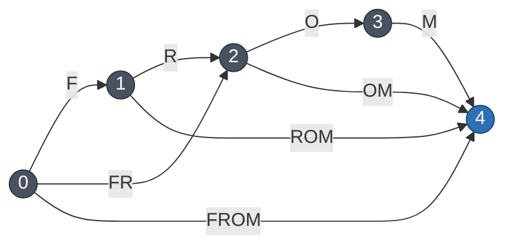
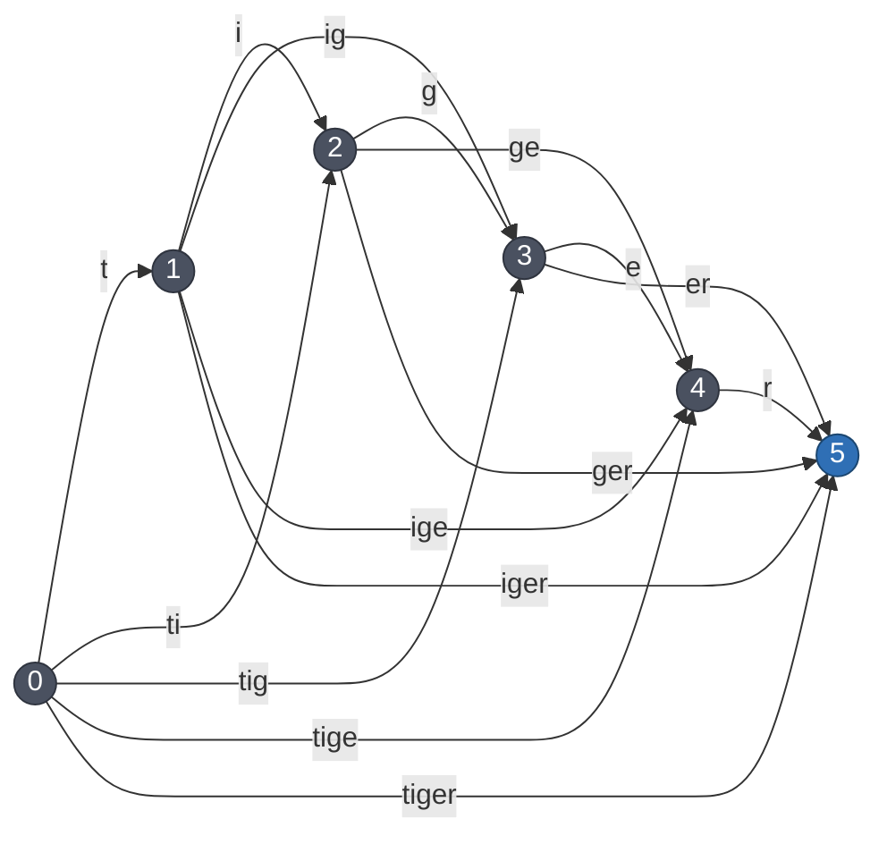

> **Open to work:** I am currently focusing on my BSc degree and looking for a part-time role either in Budapest or remote! If you have an opportunity that fits my skills, I would love to hear from you! You can reach me at [astameteo@posteo.net](mailto:astameteo@posteo.net) and my CV is available at [pinting.github.io/cv](https://pinting.github.io/cv)!

# oraculum

An incremental SQL parser and enforcer which guarantees grammatical and semantic correctness in the following subset of the language.

```xml
<statement>   := [WITH [RECURSIVE] <definition> [, <definition>]*] <query> ;
<definition>  := <name> [( <name> [, <name>]* )] AS ( <query> )

<query>       := <member> [<set operator> <member>]*
                 [ORDER BY <sort key> [, <sort key>]*] [LIMIT <count> [OFFSET <count>]]
<member>      := SELECT [DISTINCT] <items> FROM <entry> [, <entry>]*
                 [WHERE <filters>] [GROUP BY <keys> [HAVING <filters>]]
<set operator>:= UNION | UNION ALL | INTERSECT | EXCEPT

<items>       := <item> [, <item>]*
<item>        := <value> [AS <name>]
<value>       := <term> [(+ | - | * | /) <term>]*
<term>        := <field ref> | <literal> | <call> | <aggregate> | <ranking> | <case> | <subquery>
<call>        := <scalar>(<value> [, <value>]*) | CAST(<value> AS TEXT)
<scalar>      := ABS | COALESCE | LENGTH | LOWER | ROUND | TRIM | UPPER
<aggregate>   := COUNT(*) | <function>([DISTINCT] <value>) [<window>]
<function>    := COUNT | SUM | AVG | MIN | MAX
<ranking>     := (ROW_NUMBER | RANK | DENSE_RANK)() <window>
<window>      := OVER ([PARTITION BY <field ref> [, ...]] [ORDER BY <field ref> [ASC | DESC] [, ...]])
<case>        := CASE [WHEN <value> (<operator> <value> | IS [NOT] NULL) THEN <value>]+
                 [ELSE <value>] END
<field ref>   := <field> | <alias>.<field>

<entry>       := <source> [<join>]* | <subquery> AS <alias>
<join>        := <join type> <source> ON <field ref> = <field ref>
<source>      := <table> [AS <alias>]
<join type>   := INNER JOIN | LEFT JOIN | RIGHT JOIN | FULL JOIN

<keys>        := <operand> [, <operand>]*
<sort key>    := (<output name> | <operand> | <aggregate>) [ASC | DESC]
<filters>     := <predicate> [(AND | OR) <predicate>]*
<predicate>   := [NOT] (<condition> | "(" <filters> ")")
<condition>   := <operand> <operator> <operand | literal | subquery>
               | <operand> [NOT] BETWEEN <operand | literal> AND <operand | literal>
               | <operand> [NOT] IN (<literal> [, <literal>]* | <query>)
               | <operand> IS [NOT] NULL
               | EXISTS <subquery>
<subquery>    := ( <query> )
<operand>     := <field ref> | <scalar>(<operand>)
               | <aggregate>                                (in HAVING and ORDER BY)
```

## Playground

<p align="center">
  <a href="https://pinting.github.io/oraculum/">
    
    Click here to open the WASM demo which runs 100% in your browser!
  </a>
</p>

## Acknowledgement

The foundational experiments, designing the architectural layers of grammatical and semantic rulesets, were carried out with the blood and sweat of old-fashioned human work. For the later stages, Anthropic's `Claude Opus 4.6 - 5.5` and Google's `Gemini 3.1 Pro / 3.8 Flash` large language models were heavily used to port code between Python and Rust, introduce new targets and extend the supported subset of SQL. While these models are excellent tools, caution is mandatory, as they can get entangled over time if their generated spaghetti code is not tamed.

## Setup

Needs [Rust](https://rustup.rs), [UV](https://docs.astral.sh/uv/getting-started/installation)
and Python 3.14. Everything else is automatically downloaded at the versions pinned by this repository.

Each project builds itself, from its own directory:

```bash
cd seer
make build       # Build seer along with the kernel
make test        # Run the test suite
make run         # Run the interactive user demo
make live        # Run the live model demo 
```

```bash
cd kernel
make build       # Build the kernel
make benchmark   # DFA data structure benchmarks
```

```bash
make docs        # Build the WASM based web application
```

## Overview

Imagine a text box where you type SQL and the system only ever offers you tokens that lead to a valid, answerable query. You write `SELECT em` and it completes `email` but not `body` if the table you are heading towards does not have a `body`. You have not typed `FROM` yet but the system already knows which tables are still possible. When you do get to `FROM`, only the tables that can actually answer your projection show up, the `ON` clause of a join writes itself from the foreign keys and the `WHERE` clause only offers operators that make sense for the column's type. Every token the model produces is guaranteed correct, grammatically and semantically, without any post validation.

### Building blocks

**Token trees:** A language model writes in tokens, fixed pieces drawn from a vocabulary of hundreds of thousands of entries, each covering one or more characters. The same keyword can arrive as one piece or many and every way of spelling it forms a path through a graph over the character positions in the string:



Each edge is a vocabulary token whose text covers exactly those positions. A path from 0 to 4 is one valid tokenisation of `FROM`. To enforce grammar at the token level every grammatical element (a keyword, an identifier pattern, a literal format) has to become an automaton that accepts exactly the token sequences spelling it.

**Constants and patterns as automata:** A fixed keyword like `FROM` is the position graph above, already a DFA over tokens: acyclic, one accepting state, found by a single Aho-Corasick sweep of the vocabulary. A regular expression cannot be drawn as positions. Instead the states are the derivatives of the regex: strip one character and see what regex is left. The identifier pattern `[a-z_][a-z0-9_]*` has exactly two live states:


The first character class is consumed and the starred tail loops on itself. Two derivatives, two states. Transitions on vocabulary tokens walk all characters at once, pruned by a trie so that dead prefixes skip whole subtrees.

**The grammar as an NFA:** Wire the keyword constants and identifier patterns as edges in a graph whose shape is the SQL grammar. Every edge label is one of the automata from the previous step: a constant, a pattern or a difference of patterns. Walking an edge means feeding tokens into that automaton until it accepts, then following the grammar arc. Multiple edges out of one node are multiple live branches, which makes the graph an NFA. The system determinises lazily, one token at a time, rather than building the exponential product machine up front.

**Latent state, enabling and disabling routes:** The grammar graph is static: it knows that *a* field follows `SELECT` and *a* table follows `FROM`, but not which ones. A second layer, the latent state, rides alongside the walk and enables or disables edges as the query grows.

The latent state holds what the query has committed to so far. Each branch of the walk has its own copy, so one branch never sees the choices of another. An edge is offered only if the query can still be completed after taking it.

What the state tracks depends on the clause. In the projection it works out which tables could still supply the fields selected so far and withdraws any field that would contradict the selection. In the FROM clause it offers only the tables the projection needs and a join only reaches a table linked to the entry by a foreign key, which also fills in the `ON` clause. Once the FROM clause is finished its columns form a fixed table and the rest of the query is written against it: a condition may name only those columns and the type of a column decides which operators and literals can follow it. Grouping, sorting, `WITH` definitions and subqueries are tracked the same way. The terminator is not offered until the FROM clause supplies every table the projection needs.

### An example

With that machinery in place, here is how a concrete query unfolds over a real schema.

```sql
CREATE TABLE users (
    id BIGINT PRIMARY KEY,
    first_name VARCHAR(255) NOT NULL,
    last_name VARCHAR(255) NOT NULL,
    email VARCHAR(255) UNIQUE NOT NULL,
    verified BOOLEAN,
    created_at TIMESTAMP
);

CREATE TABLE posts (
    id BIGINT PRIMARY KEY,
    user_id BIGINT NOT NULL REFERENCES users(id),
    title VARCHAR(255) NOT NULL,
    body TEXT NOT NULL,
    published_at TIMESTAMP
);

CREATE TABLE comments (
    id BIGINT PRIMARY KEY,
    user_id BIGINT NOT NULL REFERENCES users(id),
    post_id BIGINT NOT NULL REFERENCES posts(id),
    body TEXT NOT NULL
);
```

**The projection:** One or more columns, each written unqualified or scoped by an alias. An alias is invented by whoever is generating, since nothing in the schema names it, so it may be any identifier that no keyword, table or column already spells: `users2` is available, `users` is taken. Aliases are introduced here and nowhere else: `FROM users AS u` is reachable only once something has written `u.` in the projection.

```sql
SELECT email, first_name FROM users;
SELECT u.email, u.first_name FROM users AS u;
```

What may be written is what the schema can still answer. `email` is on `users` alone, so writing it settles which table the clause needs. `body` is on `posts` and `comments`, so it leaves both open until something else decides between them. A name drops out once nothing that could supply it is left: after `SELECT id, title` the unqualified `id` has to come from exactly one source and `title` has pinned that source to `posts`, so `users` is out and `first_name` is no longer offered.

**The FROM clause:** One or more entries, comma separated, each a table optionally renamed by `AS`. Only tables the projection actually requires are ever offered and the statement cannot reach its terminator until every one of them has been supplied.

```sql
SELECT email, body FROM users, comments;
```

**Joins:** Any entry may be grown by any number of joins, in all four types. The target has to be a foreign key neighbour of the entry as it now stands and that settles the `ON` columns outright, since they are read off the foreign key.

```sql
SELECT email, title FROM users INNER JOIN posts ON users.id = posts.user_id;
SELECT email, title FROM users FULL JOIN posts ON users.id = posts.user_id;
SELECT title, c.body FROM posts LEFT JOIN comments AS c ON posts.id = c.post_id;
```

Joining merges the two, so a table two foreign keys away becomes reachable once the table between them is in. The second join here is only offered because the first one brought `posts` into the entry:

```sql
SELECT email, title, c.body
FROM users
INNER JOIN posts ON users.id = posts.user_id
INNER JOIN comments AS c ON posts.id = c.post_id;
```

A renamed source answers to its alias everywhere afterwards and to nothing else, so `FROM users AS u` makes the join `ON u.id = posts.user_id`, never `ON users.id`.

**The WHERE clause:** Optional and written against the relation the FROM clause produced: every column of every source it placed, joined or not. Each is reachable scoped by its source's alias or table name and unqualified wherever exactly one source supplies the name. A column does not have to be projected to be filtered on.

```sql
SELECT email FROM users WHERE created_at IS NOT NULL;
SELECT email FROM users WHERE first_name LIKE 'A%';

SELECT email, title
FROM users
INNER JOIN posts ON users.id = posts.user_id
WHERE created_at < published_at;
```

A column's type fixes which operators it may take and what may stand on the other side of them, which is what makes `created_at < published_at` a statement about two timestamps and `email = users.id` no statement at all.

Conditions combine with `AND` and `OR`, take a `NOT` in front and nest three brackets deep:

```sql
SELECT email FROM users WHERE email = 'a' AND users.id > 1;
SELECT email FROM users WHERE NOT email LIKE 'a%';
SELECT email FROM users WHERE (email = 'a' OR email = 'b') AND NOT users.id = 1;
```

**Aggregates and grouping:** An item may also be an aggregate over a column, `COUNT(*)` included, optionally named with `AS`. The function decides which columns it may take: `SUM` and `AVG` only numbers, `MIN` and `MAX` anything with an order, `COUNT` everything. A column handed to a function narrows the tables like any other column, but harder: `SUM(id)` may only be supplied by a table whose `id` is numeric.

```sql
SELECT COUNT(*) FROM users;
SELECT MIN(title), MAX(published_at) FROM posts;
SELECT user_id, COUNT(*) AS n FROM posts GROUP BY user_id;
```

Once any item aggregates, every plain item has to be grouped and the statement cannot end until it is. A key is a column of the relation the FROM clause produced, so `GROUP BY email` and `GROUP BY u.email` are the same key where one source supplies `email`. HAVING follows with the condition grammar of WHERE, over the grouped columns and aggregates of any column:

```sql
SELECT u.email, COUNT(p.id) AS posts_count
FROM users AS u
INNER JOIN posts AS p ON u.id = p.user_id
GROUP BY u.email
HAVING COUNT(p.id) >= 2;
```

**WITH: queries stacked on queries:** A statement may open with definitions, each a query of its own whose result is a table to everything after it. A definition's columns are its items, so they need names that differ: every computed item is named and no name comes twice. A projected column keeps the foreign key it had, so the join graph runs through a definition as through the table it came from:

```sql
WITH c AS (SELECT user_id, COUNT(*) AS n FROM posts GROUP BY user_id)
SELECT email, n FROM users INNER JOIN c ON users.id = c.user_id WHERE n > 1;
```

Every name a definition introduces, its own and its columns', is reserved from then on, in every spelling, since SQL hears `T` and `t` as one name.

A column list names the columns instead, so the body needs no names of its own, only as many items as the list has names:

```sql
WITH authors(author, n) AS (SELECT user_id, COUNT(*) FROM posts GROUP BY user_id)
SELECT email, n FROM users INNER JOIN authors ON users.id = authors.author;
```

**Expressions:** An item is any value: a column, a literal, a scalar function over values, arithmetic, a `CASE`, an aggregate over a value, a window. Every function says what it accepts, so `LOWER(` only offers what can be text and `id + ` only what can be a number and every item may be named:

```sql
SELECT LOWER(email) AS mail, LENGTH(TRIM(last_name)), id + 1 FROM users;
SELECT COALESCE(verified, FALSE), CAST(created_at AS TEXT) FROM users;
SELECT CASE WHEN verified IS NULL THEN 'unknown' ELSE 'known' END AS state FROM users;
SELECT COUNT(DISTINCT user_id), SUM(CASE WHEN published_at IS NULL THEN 1 ELSE 0 END) FROM posts;
```

A grouping key may be an expression too and grouping covers whatever is built from grouped values alone: `LOWER(email)` over `GROUP BY email`, but `email` not over `GROUP BY LOWER(email)`:

```sql
SELECT LOWER(email), COUNT(*) FROM users GROUP BY LOWER(email);
SELECT user_id, COUNT(*) + 1, RANK() OVER (ORDER BY user_id) FROM posts GROUP BY user_id;
```

**Conditions, sorting and limits:** A condition may range with `BETWEEN`, test membership with `IN` and take a scalar function on its left. After the body come `ORDER BY` and `LIMIT`, sorting by whatever the result can be sorted by: any value of a plain query, the grouped values and aggregates of a grouped one and the output names of a `SELECT DISTINCT`:

```sql
SELECT email FROM users WHERE users.id IN (1, 2, 3) AND created_at BETWEEN '2024-01-01' AND '2024-12-31';
SELECT user_id, COUNT(*) AS n FROM posts GROUP BY user_id ORDER BY n DESC LIMIT 3 OFFSET 1;
SELECT DISTINCT LOWER(email) AS e FROM users ORDER BY e;
```

**Compounds:** Members joined by `UNION`, `UNION ALL`, `INTERSECT` and `EXCEPT` must match the column count and types of the first member. The compound result takes the first member's column names, which can be used for sorting and limiting after the last member:

```sql
SELECT email AS label FROM users UNION SELECT title FROM posts ORDER BY label LIMIT 5;
```

**Recursion:** Under `WITH RECURSIVE` a member after a union may read the definition it belongs to, as the members before it produced it. That member stays a simple select - no aggregate, window, `DISTINCT`, grouping or sorting, the definition read once and by inner joins only - and it is the last:

```sql
WITH RECURSIVE t(n) AS (SELECT 1 FROM users UNION ALL SELECT n + 1 FROM t WHERE n < 3)
SELECT n FROM t;
```

**Subqueries:** A query may stand inside another: as the one value a
comparison takes, as the list of an `IN`, after `EXISTS`, as a value of the projection and as a table of the FROM clause. One inside a condition reads the columns of the query around it, qualified, which is what makes it correlated:

```sql
SELECT email FROM users WHERE EXISTS (SELECT title FROM posts WHERE posts.user_id = users.id);
SELECT title FROM posts WHERE published_at > (SELECT MIN(created_at) FROM users WHERE users.id = posts.user_id);
SELECT email, (SELECT COUNT(*) FROM posts) AS total FROM users;
SELECT d.user_id FROM (SELECT user_id, COUNT(*) AS n FROM posts GROUP BY user_id) AS d WHERE d.n > 1;
```

When a subquery stands for a single value, it must return one row and one column - so it must aggregate without grouping. A derived table is read through its alias and has to export what the projection already read off it.

Two things have to be true of every statement the system produces. It has to be grammatical: a well-formed word or phrase. It also has to be meaningful: something the system can actually understand. Both are enforced one token at a time while the model is writing, so neither is ever checked after the fact.

## Layers in detail

### 1. Tokens

A grammar talks about text: the word `tiger`, a comma, an identifier. A language model emits tokens from a fixed vocabulary and the same text can be split many ways.



Turning a token sequence back into text means gluing the pieces together. Call that $c$:

```math
c(v_1 v_2 \cdots v_k) \;=\; v_1 v_2 \cdots v_k
```

Gluing respects concatenation, $c(xy) = c(x)\,c(y)$, which is the only sense in which the vocabulary is a homomorphism.

What has to be enforced is the set of token sequences that glue into the set $L$ of legal texts:

```math
c^{-1}(L) \;=\; \{\, w \in V^{*} \;:\; c(w) \in L \,\}
```

For $L = \{\texttt{"tiger"}\}$ that is the handful of splits above; for an infinite $L$ it is infinite.

$c$ is many-to-one, so $c^{-1}(L)$ is the larger set. When $L$ is infinite there is nothing to enumerate, so it must be described by a machine. Regular languages are closed under inverse homomorphism, so whenever $L$ is regular, that machine is a finite automaton over $V$. The `kernel` calls it an index. Sections 2 to 4 are three ways of building one.

### 2. Constants

Take the constant `tiger`. Put a node at every byte position: before the `t`, between each pair of letters, after the `r`. Six nodes for five characters. Positions are byte offsets, so a multi-byte character spans several nodes. Draw an edge from $i$ to $j$ whenever a vocabulary token spells exactly the bytes between them.

A path from 0 to 5 is one way of spelling `tiger` and every way appears as a path, so this graph *is* $c^{-1}(\{\texttt{tiger}\})$. It is acyclic because every edge moves right and has one accepting node, the last one.

The encoding falls out of the structure. Group edges by source node and two facts eliminate most data:

- the label determines the target since $j = i + |v|$, so targets need not be stored;
- node $i$ accepts exactly when it is the last node, so the position itself is the accept flag.

The accept condition is strictly "reached the end of the constant", not "has no outgoing edges" - a byte offset in the middle of a multi-byte character also has no outgoing edges but must not accept.

What remains is the out-edge labels grouped by source: two arrays. Finding the edges is one **Aho-Corasick** pass: a single automaton holding all 255,386 tokens as patterns, built once per vocabulary, reports every token occurring anywhere in `tiger` in one sweep. A standalone Go example: [`experiments/1-aot-ahocorasick/ahocorasick.go`](experiments/1-aot-ahocorasick/ahocorasick.go).

### 3. Regular expressions

A constant has a graph you can draw directly. A regular expression has to be explored and the trick is to let the states be regular expressions themselves.

The *derivative* of a regex $r$ by a character $b$, written $\partial_b r$, is what remains after consuming just the first character $b$:

```math
\partial_b r \;=\; \{\, w \;:\; bw \in L(r) \,\}
```

Up to similarity (treating union as associative, commutative and idempotent), any regular expression has finitely many distinct derivatives, so they close into the state set of a finite automaton.

Take the identifier pattern `[a-zA-Z_][a-zA-Z0-9_]*`. Reading a `t` consumes the first character class and leaves the starred tail. Reading another letter from the tail returns the same tail:

```
  r          = [a-zA-Z_][a-zA-Z0-9_]*
  d_t(r)     = [a-zA-Z0-9_]*
  d_i(d_t(r))= [a-zA-Z0-9_]* -> The same regex, no new state
```

Two live derivatives, so exactly two states. A third derivative, $\emptyset$, is reached by starting with a digit - the dead state, never stored. Brzozowski's theorem guarantees termination: the derivatives are finite in number, so the states run out. `derivre` computes them lazily, building a state the first time it is reached. A standalone Go example: [`experiments/2-jit-derivre/brzozowski.go`](experiments/2-jit-derivre/brzozowski.go).

That gives an automaton over *characters*. One more step turns it into one over *tokens*: to take a token $v$, walk all its characters at once.

```math
\delta(q, v) \;=\; \partial_{v}\,q \quad\text{- read every character of } v \text{ in turn}
```

Naively that is 255,386 walks per state. Instead the vocabulary is stored as a trie and the walk descends it once: when a character kills a branch, every token under that prefix is dead too and the subtree is skipped.

The resulting automata are tiny in states and large in edges:

```
[a-zA-Z_][a-zA-Z0-9_]*     2 states      53,097 and 53,118 edges      849,816 bytes
[ \n\t]+                   2 states                                     1,628 bytes
```

An index costs its edge count.

### 4. Ruling out reserved words

A name is any identifier that the language and the schema have not claimed: no reserved word, no table name, no column name. That is a set difference:

```math
L(G) \;=\; L(\mathrm{inc}) \;\setminus\; \bigl( L(\mathrm{exc}_1) \cup \cdots \cup L(\mathrm{exc}_k) \bigr)
```

Regular languages are closed under difference, so an automaton exists: the product of the inclusion with the complement of each exclusion. Its state count is bounded by the product of theirs:

```math
|Q_G| \;\le\; |Q_{\mathrm{inc}}| \times |Q_{\mathrm{exc}_1}| \times \cdots \times |Q_{\mathrm{exc}_k}|
```

For the example schema $k$ is 88 and grows with the schema, so that product is never built. Instead each member stays a separate automaton. All are fed the same token and the difference is checked when the word asks whether it may end, not in the state space:

```math
\begin{aligned}
\delta_G(q, v) &= \delta_{\mathrm{inc}}(q, v) && \text{the inclusion alone decides which token may come next} \\
F_G &= F_{\mathrm{inc}} \setminus \bigl( F_1 \cup \cdots \cup F_k \bigr) && \text{every member decides whether the word may end}
\end{aligned}
```

The asymmetry fits the problem. An exclusion must never restrict the *next* token, because a longer word escapes it: `tiger` is excluded but `tiger2` is fine. An exclusion only removes the right to stop. A group whose inclusion accepts while some exclusion also accepts is *blocked*: the terminating token is withheld, forcing generation onward.

```
t        include accepts, no exclusion does             -> accepted
tiger    include accepts, the `tiger` exclusion does    -> blocked
tiger2   the `tiger` exclusion died on the `2`          -> accepted
```

One fact keeps this cheap: every member is anchored at the start of the word, so an exclusion that rejects a token can never match again. Dead members are dropped and against a real vocabulary nearly all 88 die on the first token.

The trade-off is explicit. The member automata cost $O\bigl(\sum_i |Q_i|\bigr)$ once, shared across every head; an active name adds only $O(k)$ on top, one node id per surviving member, driven towards $O(1)$ as members die. The alternative is $O\bigl(\prod_i |Q_i|\bigr)$ per input, up front.

### 5. Lazy generation of an infinite graph

The syntax graph sits above the indexes and encodes the SQL grammar. Each of its nodes is an index. Tokens are fed into a node's index until it accepts, which unlocks the node's outgoing edges: the routes the grammar allows next. Following a route resolves it into a new node whose index is the next lock to open, so the graph grows by one node each time an index completes. A node that receives a token its index cannot accept collapses and is removed from the heads of the kernel (the nodes it is currently feeding with incoming tokens).

A simplified right-linear skeleton:

```
ws     = [ \n\t]+                          (Expression: one or more whitespaces)
comma  = ,                                 (Lattice: a simple comma)
dot    = .                                 (Lattice: a period)
semi   = ;                                 (Lattice: a semicolon)

alias  = Identifier minus reserved words   (Group: invented in SELECT, bound in FROM)
field  = Available fields                  (Lattices: drawn from the semantic context)
table  = Available tables                  (Lattices: drawn from the semantic context)

ref    = field | alias dot field
fields = ref [ [ws] comma ws ref [ [ws] comma ws [ref ...] ] ]

source = table [ws AS ws alias]
from   = source [ [ws] comma ws source [ [ws] comma ws [source ...] ] ]

root   = SELECT ws fields ws FROM ws from [ws] semi
```

Lists like `fields` and `from` repeat indefinitely and every step forks into its own semantic history as aliases are invented and tables are narrowed. The full graph is infinite, so it is built lazily as the query is written. Static rules (`ws`, `comma`, `SELECT`) point to fixed indexes built once at startup. Dynamic rules (`field`, `table`, `alias`) ask the current semantic context which edges are legal and build only the next step. Each branch passes an updated copy of its context downstream, so the grammar grows one token at a time and a dead end is never built.

### 6. The semantic context / latent state

The syntax graph only knows the grammar. The latent state under it checks the meaning: whether a column exists on a table the query can still use, or whether a join follows a foreign key. Each node of the graph carries a semantic context and passes a new copy of it on to the nodes that follow, so every branch keeps its own record of what the statement has committed to.

A statement is any number of `WITH` definitions followed by the main query. Each of the queries goes through its clauses in a fixed order:

```
SELECT items -> FROM -> [WHERE] -> [GROUP BY -> [HAVING]] -> [ORDER BY] -> [LIMIT] -> end
```

Each query keeps what it has committed to in its virtual table, which has one part for each stretch of clauses. The SELECT clause collects demands on the tables. `FROM` builds a join graph over the tables still demanded and places them. When it ends, the placed tables become the relation, the fixed set of columns that `WHERE`, `GROUP BY`, `HAVING` and `ORDER BY` are written against. Rules that span clauses are checked at these boundaries: `FROM` is offered only once the SELECT clause is complete. The query cannot end until every demanded table is placed and the grouping covers every item.

#### The SELECT clause: which tables are still possible

Each table gets a variable $t_i \in \mathbb{F}_2$ that is $1$ when the table is in the FROM clause. A field in global scope is written without an alias and if the tables $T(f)$ carry it, it demands exactly one of them:

```math
C(f) = \sum_{i \in T(f)} t_i \prod_{j \in T(f) \setminus \{i\}} (1 + t_j)
```

Selecting a field multiplies its constraint into a running product $P$, which starts at $1$ and placing a table later substitutes $t = 1$. Everything the SELECT clause still allows can be read off $P$:

```math
\begin{aligned}
P \cdot C(f) = 0 &\iff f \text{ is no longer offered} \\
P|_{t=1} = 0 &\iff t \text{ contradicts the selection} \\
P|_{t_1 = \cdots = t_n = 0} = 1 &\iff \text{nothing is outstanding}
\end{aligned}
```

Selecting `body` gives $P = c + p$. Placing `posts` then leaves $c + 1$, which still forbids `comments` but holds at the origin, so the SELECT clause is satisfied.

An alias names exactly one table, so a field in alias scope narrows its candidates by intersection: after `u.email`, `u.` offers only columns of `users`. Both scopes also have to respect SQL's rule that a column in global scope has exactly one supplier, so a field is offered only if a FROM clause can still be written that gives each alias a table and supplies every column in global scope once. After `SELECT email, u.first_name FROM users`, the entry `users AS u` is never offered, because both would supply `email`.

#### Function calls

Every function says which column types each argument accepts and which type it returns. The schema's types are grouped by what can be done with them: numbers (`INT`, `BIGINT`, `DECIMAL`, ...), text (`VARCHAR`, `TEXT`, ...), dates and times (`DATE`, `TIMESTAMP`, ...), booleans and binary. E.g. `SUM` takes a number, `LOWER` takes text and returns text, `MIN` and `MAX` take anything that can be ordered (a number, text or a date) and `COUNT` takes anything.

Inside the parentheses only fields of an accepted type are offered: after `SELECT LOWER(` the offers are `email`, `first_name`, `last_name`, `title` and `body`, never `id`. A call is offered only where its return type fits, so `ROUND(ABS(` is allowed and `LOWER(ABS(` is not. Calls nest up to a fixed depth, windows are not allowed inside a call and inside an aggregate no other aggregate may start, so `SUM(COUNT(` is never offered.

A field in global scope inside a call demands exactly one of the tables carrying it, like any field in global scope, but only tables where the field has an accepted type count. If one table stored `id` as a number and another as text, writing `SUM(id)` would leave only the first as a supplier and the second could no longer be placed in `FROM`.

`MAX`, `MIN`, `SUM`, `ABS`, `ROUND` and `COALESCE` return the type of their argument, so `MAX(user_id)` has whatever type `user_id` turns out to have. When the next token needs a number, as in `MAX(user_id) +`, that requirement is passed down to `user_id`, which now has to come from a table where it is a number. `MAX(title)` is valid, since text can be ordered, but the result is text, so `+` is not offered after it. `COALESCE` needs all of its arguments to share one type, so its parse forks into one branch per type.

#### The FROM clause: graph contraction

The join graph has a vertex for each table and an edge for each foreign key, labelled with its column pair. An entry opens at a table the SELECT clause demands. A join contracts the neighbour into the entry, which makes tables two keys away reachable and the `ON` clause is read off the edge label.

#### After FROM: the fixed relation

Leaving `FROM` builds the relation: the columns of every placed table, each with its type and whether it can hold NULL. A column is always reachable in alias scope (as `u.email`) and also in global scope (as `email`) whenever only one table supplies it.

Before `FROM` a column could still come from several tables, which is why its type could still be narrowed. In the relation each column has exactly one supplier and one type, so from here on nothing is demanded or narrowed: every later clause only picks from what the relation offers. A scalar function over its columns, such as `LOWER(email)`, is one more value of the relation, of the type the function returns.

The relation never changes once it is built. The later clauses write their conditions, grouping keys and sort keys into the virtual table beside it. The query does not track what it still owes, like an item that has yet to be grouped. It works that out again from the items and the grouping keys whenever `ORDER BY`, `LIMIT` or the end of the statement might be offered.

#### WHERE: the type picks the operator

A condition is parsed left side first and the type of the left side decides what may follow. Every type takes `=` and `!=`. Numeric and temporal values also take `<`, `<=`, `>`, `>=`, `BETWEEN` and `IN`, text takes all of those and `LIKE`, while boolean and binary values stop at equality. `IS NULL` and `IS NOT NULL` are offered only where the column can hold NULL: `verified` and `created_at` can, `email` cannot and after `LEFT JOIN posts` every column of `posts` can, because the join pads the rows that found no partner.

The right side is a literal of the same type or another column of it. Each type spells its literals its own way: `42`, `'a'`, `'2024-01-01'`, `TRUE`. So `created_at < published_at` is offered and `email = users.id` never is. A column is never compared with itself, whether it is written in alias or in global scope.

A filter can never require a table or take a column away from the relation.

#### GROUP BY: every item has to be covered

An aggregate in the projection, such as `COUNT(*)`, folds the rows even without a `GROUP BY`: with no keys the whole relation is one group. An aggregate inside a window, such as `COUNT(*) OVER (...)`, folds nothing and does not count. Every other item then needs one value for the whole relation, which only an aggregate or a constant has. So `SELECT COUNT(*), 1 FROM users` can end right after `FROM`, while `SELECT email, COUNT(*) FROM users` cannot end until a `GROUP BY` makes `email` a key.

A `GROUP BY` also makes a query aggregate, with or without an aggregate item. `SELECT email FROM users GROUP BY email` is valid, but `SELECT email, first_name FROM users GROUP BY email` cannot end until `first_name` is grouped too.

Either way every item has to be covered: a grouped key, an aggregate, a constant or a value built only from covered values. `ORDER BY`, `LIMIT` and the end of the statement are offered only once every item is covered. `GROUP BY email` covers `LOWER(email)`, but `GROUP BY LOWER(email)` does not cover `email`.

A key is a column not grouped yet or a scalar function over columns, which is a key of its own. Both scopes of a column share one key, so after `GROUP BY email` neither `email` nor `users.email` is offered again.

`HAVING` reuses the condition grammar of `WHERE`. Its left side is a grouped value or an aggregate over any column and its right side a literal or a grouped value of the same type.

Ending the body, at `ORDER BY`, `LIMIT` or the end of the query, fixes the result: the output columns with their names and types. A `WITH` definition exports this result and `ORDER BY` reads its output names from it.

#### ORDER BY: how the result can be sorted

`ORDER BY` opens once the body is complete. What it offers is read off the virtual table as the body left it: the output names of the result, the values of the relation and the grouping keys. An output name is offered when exactly one item has it. A plain query also offers every value of the relation. A grouped query offers grouped values, functions over them and aggregates of any column. After `SELECT DISTINCT` and in a compound only output names remain, since rows that were deduplicated or combined have nothing else to sort by. Each sort key may take `ASC` or `DESC` and a value already sorted by is not offered again in either scope.

After `SELECT user_id, COUNT(*) AS n FROM posts GROUP BY user_id ORDER BY` the offers are `n`, `user_id` and aggregates such as `MAX(title)`, but never `title` itself. `LIMIT` and `OFFSET` only decide how many rows are returned.

#### Queries inside queries

The same grammar writes a query in any of four places. What differs is what its SELECT clause has to produce:

1. A `WITH` definition names every column.
2. A later member of a compound matches the first member's columns.
3. A subquery returns one value when it stands for a scalar and a derived table exports what the outer query read off its alias.
4. The main query produces whatever it likes.

Closed definitions form a stack that later queries read as part of the schema, so a definition is joined like any declared table and its columns keep their foreign keys. A compound is written one member at a time, each one closed before the next begins. A subquery suspends the query around it, which resumes once the subquery closes, the way a function returns to its caller. That is why one subquery grammar covers every place a subquery can appear.

## License

This project is licensed under the [GNU Affero General Public License v3.0](LICENSE).

The AGPL-3.0 is a strong copyleft license that requires you to release the source code of any modified versions of this software, including when used over a network.
