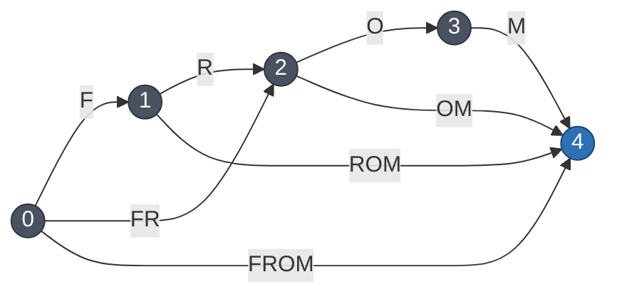
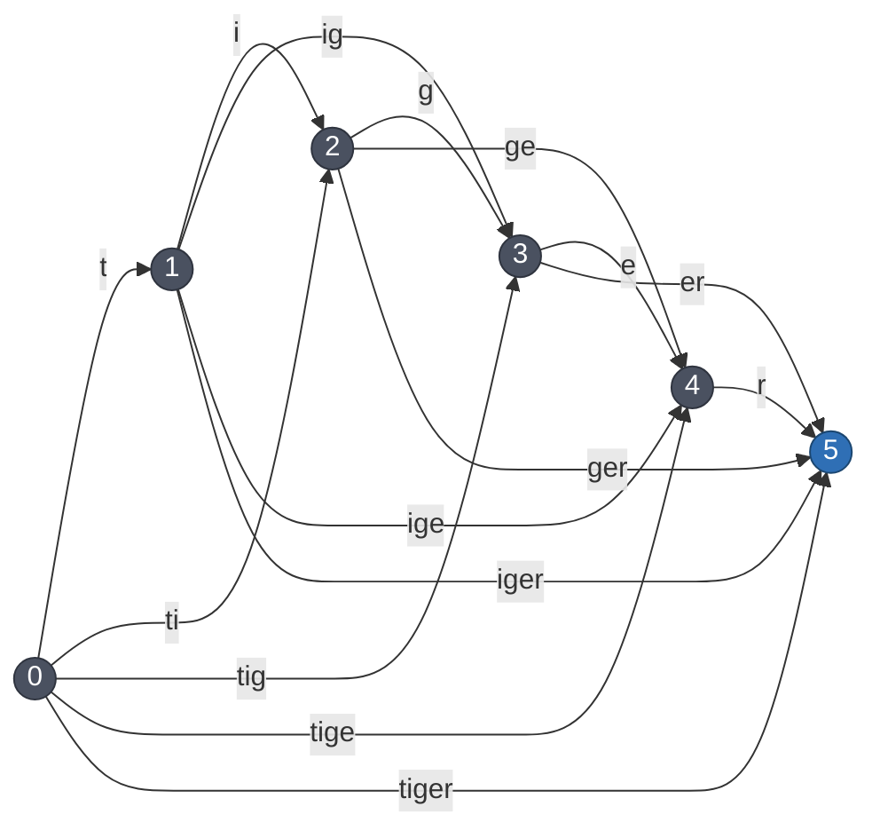

# oraculum

An SQL incremental semantic parser which guarantees grammatical and semantical correctness in the following subset of the language.

```xml
<statement>   := [WITH [RECURSIVE] <definition> [, <definition>]*] <query> ;
<definition>  := <name> [( <name> [, <name>]* )] AS ( <query> )

<query>       := <member> [<set operator> <member>]*
                 [ORDER BY <sort key> [, <sort key>]*] [LIMIT <count> [OFFSET <count>]]
<member>      := SELECT [DISTINCT] <items> FROM <entry> [, <entry>]*
                 [WHERE <filters>] [GROUP BY <keys> [HAVING <filters>]]
<set operator>:= UNION | UNION ALL | INTERSECT | EXCEPT

<items>       := <item> [, <item>]*
<item>        := <value> [AS <name>]
<value>       := <term> [(+ | - | * | /) <term>]*
<term>        := <field ref> | <literal> | <call> | <aggregate> | <ranking> | <case> | <subquery>
<call>        := <scalar>(<value> [, <value>]*) | CAST(<value> AS TEXT)
<scalar>      := ABS | COALESCE | LENGTH | LOWER | ROUND | TRIM | UPPER
<aggregate>   := COUNT(*) | <function>([DISTINCT] <value>) [<window>]
<function>    := COUNT | SUM | AVG | MIN | MAX
<ranking>     := (ROW_NUMBER | RANK | DENSE_RANK)() <window>
<window>      := OVER ([PARTITION BY <field ref> [, ...]] [ORDER BY <field ref> [ASC | DESC] [, ...]])
<case>        := CASE [WHEN <value> (<operator> <value> | IS [NOT] NULL) THEN <value>]+
                 [ELSE <value>] END
<field ref>   := <field> | <alias>.<field>

<entry>       := <source> [<join>]* | <subquery> AS <alias>
<join>        := <join type> <source> ON <column ref> = <column ref>
<source>      := <table> [AS <alias>]
<join type>   := INNER JOIN | LEFT JOIN | RIGHT JOIN | FULL JOIN

<keys>        := <operand> [, <operand>]*
<sort key>    := (<output name> | <operand> | <aggregate>) [ASC | DESC]
<filters>     := <predicate> [(AND | OR) <predicate>]*
<predicate>   := [NOT] (<condition> | "(" <filters> ")")
<condition>   := <operand> <operator> <operand | literal | subquery>
               | <operand> [NOT] BETWEEN <operand | literal> AND <operand | literal>
               | <operand> [NOT] IN (<literal> [, <literal>]* | <query>)
               | <operand> IS [NOT] NULL
               | EXISTS <subquery>
<subquery>    := ( <query> )
<operand>     := <column> | <qualifier>.<column> | <scalar>(<operand>)
               | <aggregate>                                (in HAVING and ORDER BY)
```

## Playground

<p align="center">
  <a href="https://pinting.github.io/oraculum/">
    
    Click here the open the WASM demo which runs 100% in your browser!
  </a>
</p>

## Acknowledgement

The foundational experiments, designing the architectural layers of grammatical and semantic rulesets, were carried out with the blood and sweat of old-fashioned human work. For the later stages, Anthropic's `Claude Opus 4.6 - 5.5` and Google's `Gemini 3.1 Pro / 3.8 Flash` large language models were heavily used to port code between Python and Rust, introduce new targets and extend the supported subset of SQL. While these models are excellent tools, caution is mandatory, as they can get entangled over time if their generated spaghetti code is not tamed.

## Setup

Needs [Rust](https://rustup.rs), [UV](https://docs.astral.sh/uv/getting-started/installation)
and Python 3.14. Everything else is downloaded at a version this repository
names.

Each project builds itself, from its own directory:

```bash
cd seer
make build       # Build seer along with the kernel
make test        # Run the test suite
make run         # Run the interactive user demo
make live        # Run the live model demo 
```

```bash
cd kernel
make build       # Build the kernel
make benchmark   # DFA data structure benchmarks
```

```bash
make docs        # Build the WASM based web application
```

## Overview

Imagine a text box where you type SQL and the system only ever offers you tokens that lead to a valid, answerable query. You write `SELECT em` and it completes `email` but not `body` if the table you are heading towards does not have a `body`. You have not typed `FROM` yet but the system already knows which tables are still possible. When you do get to `FROM`, only the tables that can actually answer your projection show up, the `ON` clause of a join writes itself from the foreign keys and the `WHERE` clause only offers operators that make sense for the column's type. Every token the model produces is guaranteed correct, grammatically and semantically, without any post validation.

### Building blocks

**Token trees:** A language model writes in tokens, fixed pieces drawn from a vocabulary of hundreds of thousands of entries, each covering one or more characters. The same keyword can arrive as one piece or many and every way of spelling it forms a path through a graph over the character positions in the string:



Each edge is a vocabulary token whose text covers exactly those positions. A path from 0 to 4 is one valid tokenisation of `FROM`. To enforce grammar at the token level every grammatical element (a keyword, an identifier pattern, a literal format) has to become an automaton that accepts exactly the token sequences spelling it.

**Constants and patterns as automata:** A fixed keyword like `FROM` is the position graph above, already a DFA over tokens: acyclic, one accepting state, found by a single Aho-Corasick sweep of the vocabulary. A regular expression cannot be drawn as positions. Instead the states are the derivatives of the regex: strip one character and see what regex is left. The identifier pattern `[a-z_][a-z0-9_]*` has exactly two live states:


The first character class is consumed and the starred tail loops on itself. Two derivatives, two states. Transitions on vocabulary tokens walk all characters at once, pruned by a trie so that dead prefixes skip whole subtrees.

**The grammar as an NFA:** Wire the keyword constants and identifier patterns as edges in a graph whose shape is the SQL grammar. Every edge label is one of the automata from the previous step: a constant, a pattern or a difference of patterns. Walking an edge means feeding tokens into that automaton until it accepts, then following the grammar arc. Multiple edges out of one node are multiple live branches, which makes the graph an NFA. The system determinises lazily, one token at a time, rather than building the exponential product machine up front.

**Latent state, enabling and disabling routes:** The grammar graph is static: it knows that *a* field follows `SELECT` and *a* table follows `FROM`, but not which ones. A second layer, the latent state, rides alongside the walk and enables or disables edges as the query grows.

The latent state holds what the query has committed to so far. Each branch of the walk has its own copy, so one branch never sees the choices of another. An edge is offered only if the query can still be completed after taking it.

What the state tracks depends on the clause. In the projection it works out which tables could still supply the fields selected so far and withdraws any field that would contradict the selection. In the FROM clause it offers only the tables the projection needs and a join only reaches a table linked to the entry by a foreign key, which also fills in the `ON` clause. Once the FROM clause is finished its columns form a fixed table and the rest of the query is written against it: a condition may name only those columns and the type of a column decides which operators and literals can follow it. Grouping, sorting, `WITH` definitions and subqueries are tracked the same way. The terminator is not offered until the FROM clause supplies every table the projection needs.

### An example

With that machinery in place, here is how a concrete query unfolds over a real schema.

```sql
CREATE TABLE users (
    id BIGINT PRIMARY KEY,
    first_name VARCHAR(255) NOT NULL,
    last_name VARCHAR(255) NOT NULL,
    email VARCHAR(255) UNIQUE NOT NULL,
    verified BOOLEAN,
    created_at TIMESTAMP
);

CREATE TABLE posts (
    id BIGINT PRIMARY KEY,
    user_id BIGINT NOT NULL REFERENCES users(id),
    title VARCHAR(255) NOT NULL,
    body TEXT NOT NULL,
    published_at TIMESTAMP
);

CREATE TABLE comments (
    id BIGINT PRIMARY KEY,
    user_id BIGINT NOT NULL REFERENCES users(id),
    post_id BIGINT NOT NULL REFERENCES posts(id),
    body TEXT NOT NULL
);
```

**The projection:** One or more columns, each written root or scoped by an alias. An alias is invented by whoever is generating, since nothing in the schema names it, so it may be any identifier that no keyword, table or column already spells: `users2` is available, `users` is taken. Aliases are introduced here and nowhere else: `FROM users AS u` is reachable only once something has written `u.` in the projection.

```sql
SELECT email, first_name FROM users;
SELECT u.email, u.first_name FROM users AS u;
```

What may be written is what the schema can still answer. `email` is on `users`alone, so writing it settles which table the clause needs. `body` is on `posts` and `comments`, so it leaves both open until something else decides between them. A name drops out once nothing that could supply it is left: after `SELECT id, title` the root `id` has to come from exactly one source and `title` has pinned that source to `posts`, so `users` is out and `first_name` is no longer offered.

**The FROM clause:** One or more entries, comma separated, each a table optionally renamed by `AS`. Only tables the projection actually requires are ever offered and the statement cannot reach its terminator until every one of them has been supplied.

```sql
SELECT email, body FROM users, comments;
```

**Joins:** Any entry may be grown by any number of joins, in all four types. The target has to be a foreign key neighbour of the entry as it now stands and that settles the `ON` columns outright, since they are read off the foreign key.

```sql
SELECT email, title FROM users INNER JOIN posts ON users.id = posts.user_id;
SELECT email, title FROM users FULL JOIN posts ON users.id = posts.user_id;
SELECT title, c.body FROM posts LEFT JOIN comments AS c ON posts.id = c.post_id;
```

Joining merges the two, so a table two foreign keys away becomes reachable once the table between them is in. The second join here is only offered because the first one brought `posts` into the entry:

```sql
SELECT email, title, c.body
FROM users
INNER JOIN posts ON users.id = posts.user_id
INNER JOIN comments AS c ON posts.id = c.post_id;
```

A renamed source answers to its alias everywhere afterwards and to nothing else, so `FROM users AS u` makes the join `ON u.id = posts.user_id`, never `ON users.id`.

**The WHERE clause:** Optional and written against the relation the FROM clause produced: every column of every source it placed, joined or not. Each is reachable scoped by its source's alias or table name and root wherever exactly one source supplies the name. A column does not have to be projected to be filtered on.

```sql
SELECT email FROM users WHERE created_at IS NOT NULL;
SELECT email FROM users WHERE first_name LIKE 'A%';

SELECT email, title
FROM users
INNER JOIN posts ON users.id = posts.user_id
WHERE created_at < published_at;
```

A column's type fixes which operators it may take and what may stand on the other side of them, which is what makes `created_at < published_at` a statement about two timestamps and `email = users.id` no statement at all.

Conditions combine with `AND` and `OR`, take a `NOT` in front and nest three brackets deep:

```sql
SELECT email FROM users WHERE email = 'a' AND users.id > 1;
SELECT email FROM users WHERE NOT email LIKE 'a%';
SELECT email FROM users WHERE (email = 'a' OR email = 'b') AND NOT users.id = 1;
```

**Aggregates and grouping:** An item may also be an aggregate over a column, `COUNT(*)` included, optionally named with `AS`. The function decides which columns it may take: `SUM` and `AVG` only numbers, `MIN` and `MAX` anything with an order, `COUNT` everything. A column handed to a function narrows the tables like any other column, but harder: `SUM(id)` may only be supplied by a table whose `id` is numeric.

```sql
SELECT COUNT(*) FROM users;
SELECT MIN(title), MAX(published_at) FROM posts;
SELECT user_id, COUNT(*) AS n FROM posts GROUP BY user_id;
```

Once any item aggregates, every plain item has to be grouped and the statement cannot end until it is. A key is a column of the relation the FROM clause produced, so `GROUP BY email` and `GROUP BY u.email` are the same key where one source supplies `email`. HAVING follows with the condition grammar of WHERE, over the grouped columns and aggregates of any column:

```sql
SELECT u.email, COUNT(p.id) AS posts_count
FROM users AS u
INNER JOIN posts AS p ON u.id = p.user_id
GROUP BY u.email
HAVING COUNT(p.id) >= 2;
```

**WITH: queries stacked on queries:** A statement may open with definitions, each a query of its own whose result is a table to everything after it. A definition's columns are its items, so they need names that differ: every computed item is named and no name comes twice. A projected column keeps the foreign key it had, so the join graph runs through a definition as through the table it came from:

```sql
WITH c AS (SELECT user_id, COUNT(*) AS n FROM posts GROUP BY user_id)
SELECT email, n FROM users INNER JOIN c ON users.id = c.user_id WHERE n > 1;
```

Every name a definition introduces, its own and its columns', is reserved from then on, in every spelling, since SQL hears `T` and `t` as one name.

A column list names the columns instead, so the body needs no names of its own, only as many items as the list has names:

```sql
WITH authors(author, n) AS (SELECT user_id, COUNT(*) FROM posts GROUP BY user_id)
SELECT email, n FROM users INNER JOIN authors ON users.id = authors.author;
```

**Expressions:** An item is any value: a column, a literal, a scalar function over values, arithmetic, a `CASE`, an aggregate over a value, a window. Every function says what it accepts, so `LOWER(` only offers what can be text and `id + ` only what can be a number and every item may be named:

```sql
SELECT LOWER(email) AS mail, LENGTH(TRIM(last_name)), id + 1 FROM users;
SELECT COALESCE(verified, FALSE), CAST(created_at AS TEXT) FROM users;
SELECT CASE WHEN verified IS NULL THEN 'unknown' ELSE 'known' END AS state FROM users;
SELECT COUNT(DISTINCT user_id), SUM(CASE WHEN published_at IS NULL THEN 1 ELSE 0 END) FROM posts;
```

A grouping key may be an expression too and grouping covers whatever is built from grouped values alone: `LOWER(email)` over `GROUP BY email`, but `email` not over `GROUP BY LOWER(email)`:

```sql
SELECT LOWER(email), COUNT(*) FROM users GROUP BY LOWER(email);
SELECT user_id, COUNT(*) + 1, RANK() OVER (ORDER BY user_id) FROM posts GROUP BY user_id;
```

**Conditions, sorting and limits:** A condition may range with `BETWEEN`, test membership with `IN` and take a scalar function on its left. After the body come `ORDER BY` and `LIMIT`, sorting by whatever the result can be sorted by: any value of a plain query, the grouped values and aggregates of a grouped one and the output names of a `SELECT DISTINCT`:

```sql
SELECT email FROM users WHERE users.id IN (1, 2, 3) AND created_at BETWEEN '2024-01-01' AND '2024-12-31';
SELECT user_id, COUNT(*) AS n FROM posts GROUP BY user_id ORDER BY n DESC LIMIT 3 OFFSET 1;
SELECT DISTINCT LOWER(email) AS e FROM users ORDER BY e;
```

**Compounds:** Members joined by `UNION`, `UNION ALL`, `INTERSECT` and `EXCEPT` produce the first member's columns, each as many and of the same class and the compound is sorted and limited after its last member, by the first member's names:

```sql
SELECT email AS label FROM users UNION SELECT title FROM posts ORDER BY label LIMIT 5;
```

**Recursion:** Under `WITH RECURSIVE` a member after a union may read the definition it belongs to, as the members before it produced it. That member stays a simple select - no aggregate, window, `DISTINCT`, grouping or sorting, the definition read once and by inner joins only - and it is the last:

```sql
WITH RECURSIVE t(n) AS (SELECT 1 FROM users UNION ALL SELECT n + 1 FROM t WHERE n < 3)
SELECT n FROM t;
```

**Subqueries:** A query may stand inside another: as the one value a
comparison takes, as the list of an `IN`, after `EXISTS`, as a value of the projection and as a table of the FROM clause. One inside a condition reads the columns of the query around it, qualified, which is what makes it correlated:

```sql
SELECT email FROM users WHERE EXISTS (SELECT title FROM posts WHERE posts.user_id = users.id);
SELECT title FROM posts WHERE published_at > (SELECT MIN(created_at) FROM users WHERE users.id = posts.user_id);
SELECT email, (SELECT COUNT(*) FROM posts) AS total FROM users;
SELECT d.user_id FROM (SELECT user_id, COUNT(*) AS n FROM posts GROUP BY user_id) AS d WHERE d.n > 1;
```

A value is one row of one column, so its query aggregates and does not group. A derived table is read through its alias and has to export what the projection already read off it.

Two things have to be true of every statement the system produces. It has to be grammatical: a well-formed word or phrase. It also has to be meaningful something the system can actually understand. Both are enforced one token at a time while the model is writing, so neither is ever checked after the fact.

## Layers in detail

### 1. Tokens: characters, words, pieces of text

A grammar talks about text: the word `tiger`, a comma, an identifier. A language model emits tokens from a fixed vocabulary, and the same text can be split many ways.



Turning a token sequence back into text means gluing the pieces together. Call that $c$:

```math
c(v_1 v_2 \cdots v_k) \;=\; v_1 v_2 \cdots v_k
```

Gluing respects concatenation, $c(xy) = c(x)\,c(y)$, which is the only sense in which the vocabulary is a homomorphism.

What has to be enforced is the set of token sequences that glue into the set $L$ of legal texts:

```math
c^{-1}(L) \;=\; \{\, w \in V^{*} \;:\; c(w) \in L \,\}
```

For $L = \{\texttt{"tiger"}\}$ that is the handful of splits above; for an infinite $L$ it is infinite.

$c$ is many-to-one, so $c^{-1}(L)$ is the larger set. When $L$ is infinite there is nothing to enumerate, so it must be described by a machine. Regular languages are closed under inverse homomorphism, so whenever $L$ is regular, that machine is a finite automaton over $V$. The `kernel` calls it an index. Sections 2 to 4 are three ways of building one.

### 2. Constants: a graph over the gaps in a string

Take the constant `tiger`. Put a node at every byte position: before the `t`, between each pair of letters, after the `r`. Six nodes for five characters. Positions are byte offsets, so a multi-byte character spans several nodes. Draw an edge from $i$ to $j$ whenever a vocabulary token spells exactly the bytes between them.

A path from 0 to 5 is one way of spelling `tiger` and every way appears as a path, so this graph *is* $c^{-1}(\{\texttt{tiger}\})$. It is acyclic because every edge moves right and has one accepting node, the last one.

The encoding falls out of the structure. Group edges by source node and two facts eliminate most data:

- the label determines the target since $j = i + |v|$, so targets need not be stored;
- node $i$ accepts exactly when it is the last node, so the position itself is the accept flag.

The accept condition is strictly "reached the end of the constant", not "has no outgoing edges" - a byte offset in the middle of a multi-byte character also has no outgoing edges but must not accept.

What remains is the out-edge labels grouped by source: two arrays. Finding the edges is one **Aho-Corasick** pass: a single automaton holding all 255,386 tokens as patterns, built once per vocabulary, reports every token occurring anywhere in `tiger` in one sweep. A standalone Go example: [`experiments/1-aot-ahocorasick/ahocorasick.go`](experiments/1-aot-ahocorasick/ahocorasick.go).

### 3. Regular expressions: a state is the regex that is left

A constant has a graph you can draw directly. A regular expression has to be explored and the trick is to let the states be regular expressions themselves.

The *derivative* of a regex $r$ by a character $b$, written $\partial_b r$, is what remains after consuming just the first character $b$:

```math
\partial_b r \;=\; \{\, w \;:\; bw \in L(r) \,\}
```

Up to similarity (treating union as associative, commutative and idempotent), any regular expression has finitely many distinct derivatives, so they close into the state set of a finite automaton.

Take the identifier pattern `[a-zA-Z_][a-zA-Z0-9_]*`. Reading a `t` consumes the first character class and leaves the starred tail. Reading another letter from the tail returns the same tail:

```
  r          = [a-zA-Z_][a-zA-Z0-9_]*
  d_t(r)     = [a-zA-Z0-9_]*
  d_i(d_t(r))= [a-zA-Z0-9_]* -> The same regex, no new state
```

Two live derivatives, so exactly two states. A third derivative, $\emptyset$, is reached by starting with a digit - the dead state, never stored. Brzozowski's theorem guarantees termination: the derivatives are finite in number, so the states run out. `derivre` computes them lazily, building a state the first time it is reached. A standalone Go example: [`experiments/2-jit-derivre/brzozowski.go`](experiments/2-jit-derivre/brzozowski.go).

That gives an automaton over *characters*. One more step turns it into one over *tokens*: to take a token $v$, walk all its characters at once.

```math
\delta(q, v) \;=\; \partial_{v}\,q \quad\text{- read every character of } v \text{ in turn}
```

Naively that is 255,386 walks per state. Instead the vocabulary is stored as a trie and the walk descends it once: when a character kills a branch, every token under that prefix is dead too and the subtree is skipped.

The resulting automata are tiny in states and large in edges:

```
[a-zA-Z_][a-zA-Z0-9_]*     2 states      53,097 and 53,118 edges      849,816 bytes
[ \n\t]+                   2 states                                     1,628 bytes
```

An index costs its edge count.

### 4. Ruling out reserved words

A name is any identifier that the language and the schema have not claimed: no reserved word, no table name, no column name. That is a set difference:

```math
L(G) \;=\; L(\mathrm{inc}) \;\setminus\; \bigl( L(\mathrm{exc}_1) \cup \cdots \cup L(\mathrm{exc}_k) \bigr)
```

Regular languages are closed under difference, so an automaton exists: the product of the inclusion with the complement of each exclusion. Its state count is bounded by the product of theirs:

```math
|Q_G| \;\le\; |Q_{\mathrm{inc}}| \times |Q_{\mathrm{exc}_1}| \times \cdots \times |Q_{\mathrm{exc}_k}|
```

For the example schema $k$ is 88 and grows with the schema, so that product is never built. Instead each member stays a separate automaton. All are fed the same token and the difference is checked when the word asks whether it may end, not in the state space:

```math
\begin{aligned}
\delta_G(q, v) &= \delta_{\mathrm{inc}}(q, v) && \text{the inclusion alone decides which token may come next} \\
F_G &= F_{\mathrm{inc}} \setminus \bigl( F_1 \cup \cdots \cup F_k \bigr) && \text{every member decides whether the word may end}
\end{aligned}
```

The asymmetry fits the problem. An exclusion must never restrict the *next* token, because a longer word escapes it: `tiger` is excluded but `tiger2` is fine. An exclusion only removes the right to stop. A group whose inclusion accepts while some exclusion also accepts is *blocked*: the terminating token is withheld, forcing generation onward.

```
t        include accepts, no exclusion does             -> accepted
tiger    include accepts, the `tiger` exclusion does    -> blocked
tiger2   the `tiger` exclusion died on the `2`          -> accepted
```

One fact keeps this cheap: every member is anchored at the start of the word, so an exclusion that rejects a token can never match again. Dead members are dropped and against a real vocabulary nearly all 88 die on the first token.

The trade-off is explicit. The member automata cost $O\bigl(\sum_i |Q_i|\bigr)$ once, shared across every head; an active name adds only $O(k)$ on top, one node id per surviving member, driven towards $O(1)$ as members die. The alternative is $O\bigl(\prod_i |Q_i|\bigr)$ per input, up front.

### 5. Lazy generation of an infinite graph

Above the indexes sits the syntax graph: the SQL grammar, where each edge is an index and walking an edge means feeding tokens into that index until it accepts.

A simplified right-linear skeleton:

```
ws     = [ \n\t]+                          (Expression: one or more whitespaces)
comma  = ,                                 (Lattice: a simple comma)
dot    = .                                 (Lattice: a period)
semi   = ;                                 (Lattice: a semicolon)

alias  = Identifier minus reserved words   (Group: invented in SELECT, bound in FROM)
field  = Available fields                  (Lattices: drawn from the semantic context)
table  = Available tables                  (Lattices: drawn from the semantic context)

ref    = field | alias dot field
fields = ref [ [ws] comma ws ref [ [ws] comma ws [ref ...] ] ]

source = table [ws AS ws alias]
from   = source [ [ws] comma ws source [ [ws] comma ws [source ...] ] ]

root   = SELECT ws fields ws FROM ws from [ws] semi
```

Lists like `fields` and `from` repeat indefinitely. Each step forks into its own semantic history as aliases are invented and tables are narrowed. The full graph is infinite and cannot be built ahead of time.

Instead it is built lazily as the query is written. Static rules (`ws`, `comma`, `SELECT`) point to fixed indexes built once at startup. Dynamic rules (`field`, `table`, `alias`) ask the current semantic context which edges are legal and build only the next step. Each branch passes an updated copy of its context downstream, extending the grammar one token at a time and pruning dead ends before they exist.

### 6. The latent state

Every rule runs against a `Context` that holds what the statement has committed to so far: the stack of closed definitions and the query being written. A rule never changes a context in place - it copies it, so branches never see each other's choices.

The active query is a virtual table advanced by a state machine keyed on SQL keywords. As the `SELECT` unfolds, each keyword transition builds the next stage: tracking selected columns during the projection, building the join graph in `FROM`, filtering against the resulting relation in `WHERE`, `GROUP BY` and `HAVING`, then sorting or limiting. Invariants are enforced at these boundaries - the projection must be complete before `FROM`, all required tables and grouping keys must be satisfied before the body closes. A statement-level state machine above it tracks which query is open across `WITH` definitions, compound members and the main query, delegating the semantic work to the virtual table.

#### 6.1 Root fields via algebra over a boolean polynomial ring

Write $t_1, \ldots, t_n$ for the tables, each a variable that is $1$ when the table is in the FROM clause. Selecting an unqualified field constrains those variables. The constraint is a Boolean function.

Any Boolean function can be written as a polynomial over $\mathbb{F}_2$, the field with two elements, where addition is XOR and multiplication is AND:

```math
R \;=\; \mathbb{F}_2[t_1, \ldots, t_n] \,\big/ \, (t_i^2 - t_i)

```

The quotient says $t^2 = t$: a table is either present or not.

A field $f$ that exists in tables $T(f)$ demands that *exactly one of them* appears in FROM. The polynomial is straightforward for one or two tables and needs correction terms beyond that:

```math
\begin{aligned}
|T(f)| = 1 : \quad C(f) &= a \\
|T(f)| = 2 : \quad C(f) &= a + b && \text{plain XOR} \\
|T(f)| = 3 : \quad C(f) &= a + b + c \;+\; abc \\
|T(f)| = 4 : \quad C(f) &= a + b + c + d \;+\; abc + abd + acd + bcd
\end{aligned}

```

For two tables, exactly-one is XOR. For three, $a + b + c$ over $\mathbb{F}_2$ is the parity function - true when an odd number of tables are present. That includes the all-three case, which the $abc$ term cancels.

In general $C(f)$ sums over every odd-sized subset of $T(f)$:

```math
C(f) \;=\; \sum_{\substack{S \subseteq T(f) \\ |S| \text{ odd}}} \;\; \prod_{i \in S} t_i

```

Selecting a field multiplies its constraint into a running product (AND):

```math
P \;\leftarrow\; P \cdot C(f), \qquad P \text{ starts at } 1

```

$P$ is the latent state: the function that is $1$ on exactly those FROM clauses consistent with everything selected so far. Every question about the selection reduces to evaluating $P$:

```math
\begin{aligned}
P = 0 \quad&\Longleftrightarrow\quad \text{the selection is contradictory} \\
P|_{t = 1} = 0 \quad&\Longleftrightarrow\quad \text{table } t \text{ contradicts the selection} \\
P|_{t_1 = \cdots = t_n = 0} = 1 \quad&\Longleftrightarrow\quad \text{nothing is outstanding: the query is satisfied} \\
P \cdot C(f) = 0 \quad&\Longleftrightarrow\quad \text{field } f \text{ is excluded} \\
\bigl\{\, t \in \mathrm{vars}(P) \;:\; P|_{t = 1} \neq 0 \,\bigr\} \quad&=\quad \text{the tables still able to satisfy it}
\end{aligned}

```

`vars(P)` restricts the search to tables still required by the projection, not merely compatible ones. Already-placed tables are substituted out of $P$; they are tracked separately so they cannot be placed twice.

Selecting a field twice changes nothing: `body` and `user_id` both live in `{comments, posts}`, so selecting both leaves $P = c + p$, because $(c+p)^2 = c+p$.

Placing a table is substitution: setting $u = 1$ satisfies every constraint mentioning `users`. The remainder is rarely the constant $1$. Selecting `body` then placing `posts` leaves $P = c + 1$. This still forbids `comments`, but $P$ evaluates to $1$ at the origin, which is where satisfaction is tested.

#### 6.2 Aliased fields via intersection

An alias stands for exactly one table, so its fields narrow towards a single table. No ring arithmetic is needed.

#### 6.3 Table selection via graph contraction

Joining two tables contracts their vertices in the foreign-key graph so the pair acts as a single relation with their combined columns and neighbours. The `ON` columns come from the edge label, so the join condition is determined automatically. Tables two hops away become reachable through the merged vertex. Once the query leaves `FROM`, the sources lock into a fixed relation for the rest of the query. Later clauses reference columns by alias, table name, or bare name if the column is unambiguous.

#### 6.4 Enforcing column types

Every column carries a type class (numeric, text, temporal, boolean, binary, or unknown) that determines which operators, literals, and comparable columns may follow it. Because the left operand is already written when operators are offered, its type class travels in the parser continuation rather than the context. Columns with no valid operators are never offered as left operands.

#### 6.5 Aggregates and grouping

Typed functions like `SUM` or `LOWER` restrict $P$ to tables that supply the argument in a matching type class, while excluding other tables that share the bare column name. When a query aggregates or groups, every projected item must be covered by a `GROUP BY` key, be an aggregate or constant, or be built entirely from covered values. The query cannot close until all projected items are covered.

#### 6.6 Sorting: what the result can be sorted by

`ORDER BY` keys depend on the query type: plain queries allow any relation column or unique output name; aggregated queries allow grouped values and aggregates; `DISTINCT` or compound queries allow only output names. Each key may appear at most once. `ORDER BY` (and its trailing comma) is only offered while sortable keys remain.

#### 6.7 Compounds and recursion

In compound queries (`UNION`, `INTERSECT`, `EXCEPT`), the first member fixes the column count and type classes that later members must match. Under `WITH RECURSIVE`, the catalog exposes a provisional table for the preceding members' output so the recursive term can reference itself before the definition closes. The recursive member is restricted to a simple inner-join `SELECT` with no aggregates, grouping or further set operators.

#### 6.8 Subqueries via a call stack of virtual tables

Nested subqueries (up to two levels deep) are managed with a call stack that records where the outer grammar resumes and what shape the subquery must return - a single aggregated row for scalar comparisons, a matching column contract for derived tables, and so on. Subqueries in conditions can read outer columns when properly qualified; projection and `FROM` subqueries are isolated from outer scopes.

#### 6.9 WITH via a stack of virtual tables

Closed CTE definitions are pushed onto an immutable stack as virtual tables alongside the physical schema. Projected columns keep their types, nullability and schema origins, so foreign keys can join across definitions. The stack is persistent, so branches in the syntax graph safely share all catalog layers.

## License

This project is licensed under the [GNU Affero General Public License v3.0](LICENSE).

The AGPL-3.0 is a strong copyleft license that requires you to release the source code of any modified versions of this software, including when used over a network.
