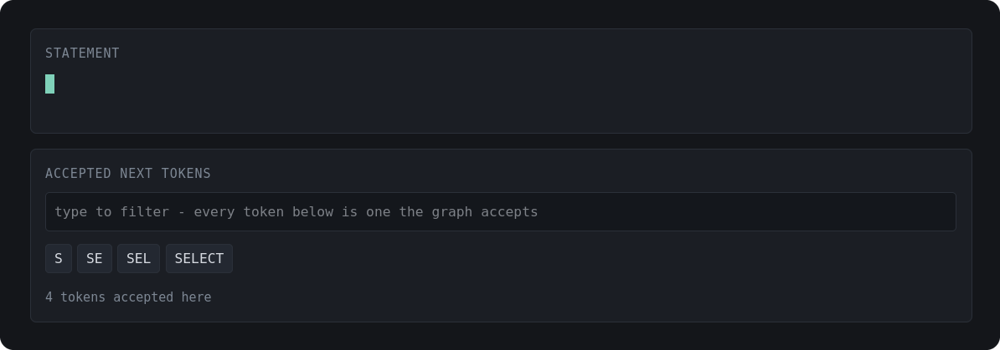
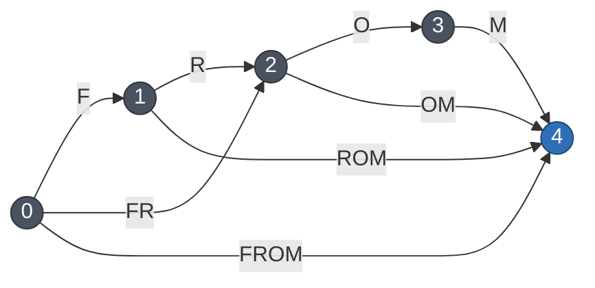
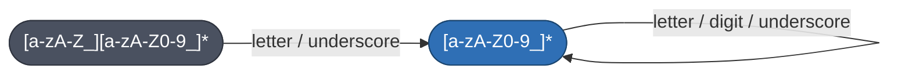
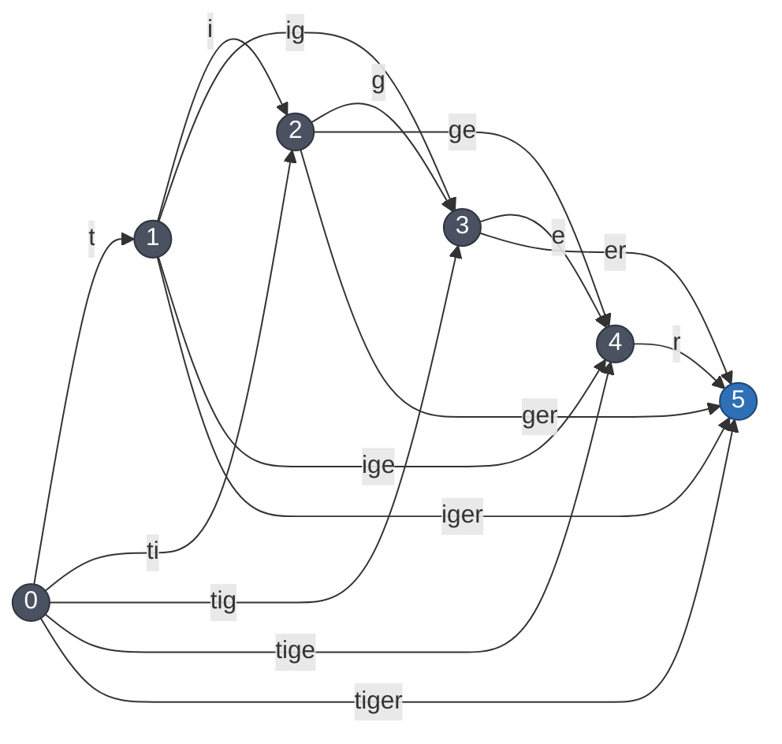

> 💼 **Open to work** · [astameteo@posteo.net](mailto:astameteo@posteo.net) · [CV](https://pinting.github.io/cv)

# oraculum

An incremental SQL parser and enforcer which guarantees grammatical and semantic correctness in the following subset of the language.

```xml
<statement>   := [WITH [RECURSIVE] <definition> [, <definition>]*] <query> ;
<definition>  := <name> [( <name> [, <name>]* )] AS ( <query> )

<query>       := <member> [<set operator> <member>]*
                 [ORDER BY <sort key> [, <sort key>]*] [LIMIT <count> [OFFSET <count>]]
<member>      := SELECT [DISTINCT] <items> FROM <entry> [, <entry>]*
                 [WHERE <filters>] [GROUP BY <keys> [HAVING <filters>]]
<set operator>:= UNION | UNION ALL | INTERSECT | EXCEPT

<items>       := <item> [, <item>]*
<item>        := <value> [AS <name>]
<value>       := <term> [(+ | - | * | /) <term>]*
<term>        := <field ref> | <literal> | <call> | <aggregate> | <ranking> | <case> | <subquery>
<call>        := <scalar>(<value> [, <value>]*) | CAST(<value> AS TEXT)
<scalar>      := ABS | COALESCE | LENGTH | LOWER | ROUND | TRIM | UPPER
<unary scalar>:= ABS | LENGTH | LOWER | ROUND | TRIM | UPPER
<aggregate>   := (COUNT(*) | <function>(<value>)) [<window>] | <function>(DISTINCT <value>)
<function>    := COUNT | SUM | AVG | MIN | MAX
<ranking>     := (ROW_NUMBER | RANK | DENSE_RANK)() <window>
<window>      := OVER ([PARTITION BY <field ref> [, ...]] [ORDER BY <field ref> [ASC | DESC] [, ...]])
<case>        := CASE [WHEN <value> (<operator> <value> | IS [NOT] NULL) THEN <value>]+
                 [ELSE <value>] END
<field ref>   := <field> | (<table | alias>).<field>

<entry>       := <source> [<join>]* | <subquery> AS <alias>
<join>        := <join type> <source> ON <field ref> = <field ref>
<source>      := <table> [AS <alias>]
<join type>   := INNER JOIN | LEFT JOIN | RIGHT JOIN | FULL JOIN

<keys>        := <operand> [, <operand>]*
<sort key>    := (<output name> | <operand> | <aggregate>) [ASC | DESC]
<filters>     := <predicate> [(AND | OR) <predicate>]*
<predicate>   := [NOT] (<condition> | ( <filters> ))
<condition>   := <operand> <operator> <operand | literal | subquery>
               | <operand> [NOT] BETWEEN <operand | literal> AND <operand | literal>
               | <operand> [NOT] IN (<literal> [, <literal>]* | <query>)
               | <operand> IS [NOT] NULL
               | EXISTS <subquery>
<subquery>    := ( <query> )
<operand>     := <field ref> | <unary scalar>(<operand>)
               | <aggregate>                                (in HAVING and ORDER BY)
```

## Playground

<p align="center">
  <a href="https://pinting.github.io/oraculum/">
    
    Click here to open the WASM demo which runs 100% in your browser!
  </a>
</p>

## Acknowledgement

The foundational experiments, designing the architectural layers of grammatical and semantic rulesets, were carried out with the blood and sweat of old-fashioned human work. For the later stages, Anthropic's `Claude Opus 4.6 - 5.5` and Google's `Gemini 3.1 Pro / 3.8 Flash` large language models were heavily used to port code between Python and Rust, introduce new targets and extend the supported subset of SQL. While these models are excellent tools, caution is mandatory, as they can get entangled over time if their generated spaghetti code is not tamed.

## Setup

Needs [Rust](https://rustup.rs), [UV](https://docs.astral.sh/uv/getting-started/installation)
and Python 3.14. Everything else is automatically downloaded at the versions pinned by this repository.

Each project builds itself, from its own directory:

```bash
cd seer
make build       # Build seer along with the kernel
make test        # Run the test suite
make run         # Run the interactive user demo
make live        # Run the live model demo 
```

```bash
cd kernel
make build       # Build the kernel
make benchmark   # DFA data structure benchmarks
```

```bash
make docs        # Build the WASM based web application
```

## Overview

Imagine a text box where you type SQL and the system only ever offers you tokens that lead to a valid, answerable query. You write `SELECT em` and it completes `email` but not `body` if the table you are heading towards does not have a `body`. You have not typed `FROM` yet but the system already knows which tables are still possible. When you do get to `FROM`, only the tables that can actually answer your projection show up, the `ON` clause of a join writes itself from the foreign keys and the `WHERE` clause only offers operators that make sense for the column's type. Every token the model produces is guaranteed correct, grammatically and semantically, without any post validation.

### Building blocks

**Token trees:** A language model writes in tokens, fixed pieces drawn from a vocabulary of hundreds of thousands of entries, each covering one or more characters. The same keyword can arrive as one piece or many and every way of spelling it forms a path through a graph over the character positions in the string:



Each edge is a vocabulary token whose text covers exactly those positions. A path from 0 to 4 is one valid tokenisation of `FROM`. To enforce grammar at the token level every grammatical element (a keyword, an identifier pattern, a literal format) has to become an automaton that accepts exactly the token sequences spelling it.

**Constants and patterns as automata:** A fixed keyword like `FROM` is the position graph above, already a DFA over tokens: acyclic, one accepting state, found by a single Aho-Corasick sweep of the vocabulary. A regular expression cannot be drawn as positions. Instead the states are the derivatives of the regex: strip one character and see what regex is left. The identifier pattern `[a-zA-Z_][a-zA-Z0-9_]*` has exactly two live states:



The first character class is consumed and the starred tail loops on itself. Two derivatives, two states. Transitions on vocabulary tokens walk all characters at once, pruned by a trie so that dead prefixes skip whole subtrees.

**The grammar as an NFA:** Wire the keyword constants and identifier patterns as edges in a graph whose shape is the SQL grammar. Every edge label is one of the automata from the previous step: a constant, a pattern or a difference of patterns. Walking an edge means feeding tokens into that automaton until it accepts, then following the grammar arc. Multiple edges out of one node are multiple live branches, which makes the graph an NFA. Instead of building an exponential product machine up front, the runtime tracks every live branch as an active head, advancing them one token at a time and dropping any branch that rejects the token.

**Latent state, enabling and disabling routes:** The grammar graph is static: it knows that *a* field follows `SELECT` and *a* table follows `FROM`, but not which ones. A second layer, the latent state, rides alongside the walk and enables or disables edges as the query grows.

The latent state holds what the query has committed to so far. Each branch of the walk has its own copy, so one branch never sees the choices of another. An edge is offered only if the query can still be completed after taking it.

What the state tracks depends on the clause. In the projection it works out which tables could still supply the fields selected so far and withdraws any field that would contradict the selection. In the FROM clause it offers the tables the projection needs. When the projection imposes no table demands, as with `COUNT(*)` or a constant literal, any table in the schema may open the clause. Joins may add foreign key neighbors, including intermediate tables needed to reach distant tables or filter on in later clauses, as long as they do not conflict with the selection. Once the FROM clause is finished its columns form a fixed table and the rest of the query is written against it: a condition may name only those columns and the type of a column decides which operators and literals can follow it. Grouping, sorting, `WITH` definitions and subqueries are tracked the same way. The terminator is not offered until the FROM clause supplies every table the projection needs.

### An example

With that machinery in place, here is how a concrete query unfolds over a real schema.

```sql
CREATE TABLE users (
    id BIGINT PRIMARY KEY,
    first_name VARCHAR(255) NOT NULL,
    last_name VARCHAR(255) NOT NULL,
    email VARCHAR(255) UNIQUE NOT NULL,
    verified BOOLEAN,
    created_at TIMESTAMP
);

CREATE TABLE posts (
    id BIGINT PRIMARY KEY,
    user_id BIGINT NOT NULL REFERENCES users(id),
    title VARCHAR(255) NOT NULL,
    body TEXT NOT NULL,
    published_at TIMESTAMP
);

CREATE TABLE comments (
    id BIGINT PRIMARY KEY,
    user_id BIGINT NOT NULL REFERENCES users(id),
    post_id BIGINT NOT NULL REFERENCES posts(id),
    body TEXT NOT NULL
);
```

**The projection:** One or more columns, each written unqualified or scoped by an alias. An alias is invented by whoever is generating, since nothing in the schema names it, so it may be any identifier that no keyword, table or column already spells: `users2` is available, `users` is taken. For base tables, aliases are introduced here: `FROM users AS u` is reachable only once something has written `u.` in the projection. Base tables cannot introduce aliases solely in `FROM` or `JOIN` to disambiguate `WHERE` conditions; disambiguation requires qualifying the projection with that alias. (Derived tables follow the same rule when the projection reads from them, but can introduce an alias directly in `FROM` when the projection makes no table demands.)

```sql
SELECT email, first_name FROM users;
SELECT u.email, u.first_name FROM users AS u;
```

What may be written is what the schema can still answer. `email` is on `users` alone, so writing it settles which table the clause needs. `body` is on `posts` and `comments`, so it leaves both open until something else decides between them. A name drops out once nothing that could supply it is left: after `SELECT id, title` the unqualified `id` has to come from exactly one source and `title` has pinned that source to `posts`, so `users` is out and `first_name` is no longer offered.

**The FROM clause:** One or more entries, comma separated, each a table optionally renamed by `AS`. Where the projection demands specific tables, only those tables may open an entry. When the projection demands no tables, as in `SELECT COUNT(*)` or `SELECT 1`, any table in the schema may open the clause. The statement cannot reach its terminator until every table the projection demanded has been supplied.

```sql
SELECT email, body FROM users, comments;
```

**Joins:** Any entry may be grown by any number of joins, in all four types. The target has to be a foreign key neighbour of the entry as it now stands and that settles the `ON` columns outright, since they are read off the foreign key. A join can add any compatible foreign key neighbor, including intermediate tables not required by the projection that bridge toward distant tables or supply columns to filter on in `WHERE`.

```sql
SELECT email, title FROM users INNER JOIN posts ON users.id = posts.user_id;
SELECT email, title FROM users FULL JOIN posts ON users.id = posts.user_id;
SELECT title, c.body FROM posts LEFT JOIN comments AS c ON posts.id = c.post_id;
```

Joining merges the two, so a table two foreign keys away becomes reachable once the table between them is in. The second join here is only offered because the first one brought `posts` into the entry:

```sql
SELECT email, title, c.body
FROM users
INNER JOIN posts ON users.id = posts.user_id
INNER JOIN comments AS c ON posts.id = c.post_id;
```

A renamed source answers to its alias everywhere afterwards and to nothing else, so `FROM users AS u` makes the join `ON u.id = posts.user_id`, never `ON users.id`.

**The WHERE clause:** Optional and written against the relation the FROM clause produced: every column of every source it placed, joined or not. Each is reachable scoped by its source's alias or table name and unqualified wherever exactly one source supplies the name. A column does not have to be projected to be filtered on.

```sql
SELECT email FROM users WHERE created_at IS NOT NULL;
SELECT email FROM users WHERE first_name LIKE 'A%';

SELECT email, title
FROM users
INNER JOIN posts ON users.id = posts.user_id
WHERE created_at < published_at;
```

A column's type fixes which operators it may take and what may stand on the other side of them, which is what makes `created_at < published_at` a statement about two timestamps and `email = users.id` no statement at all.

Conditions combine with `AND` and `OR`, take a `NOT` in front and nest three brackets deep:

```sql
SELECT email FROM users WHERE email = 'a' AND users.id > 1;
SELECT email FROM users WHERE NOT email LIKE 'a%';
SELECT email FROM users WHERE (email = 'a' OR email = 'b') AND NOT users.id = 1;
```

**Aggregates and grouping:** An item may also be an aggregate over a column, `COUNT(*)` included, optionally named with `AS`. The function decides which columns it may take: `SUM` and `AVG` only numbers, `MIN` and `MAX` anything with an order, `COUNT` everything. A column handed to a function narrows the tables like any other column, but harder: `SUM(id)` may only be supplied by a table whose `id` is numeric.

```sql
SELECT COUNT(*) FROM users;
SELECT MIN(title), MAX(published_at) FROM posts;
SELECT user_id, COUNT(*) AS n FROM posts GROUP BY user_id;
```

Once any item aggregates, every plain item has to be grouped and the statement cannot end until it is. A key is a column of the relation the FROM clause produced, so `GROUP BY email` and `GROUP BY u.email` are the same key where one source supplies `email`. HAVING follows with the condition grammar of WHERE, over the grouped columns and aggregates of any column:

```sql
SELECT u.email, COUNT(p.id) AS posts_count
FROM users AS u
INNER JOIN posts AS p ON u.id = p.user_id
GROUP BY u.email
HAVING COUNT(p.id) >= 2;
```

**WITH: queries stacked on queries:** A statement may open with definitions, each a query of its own whose result is a table to everything after it. A definition's columns are its items, so they need names that differ: every computed item is named and no name comes twice. A projected column keeps the foreign key it had, so the join graph runs through a definition as through the table it came from:

```sql
WITH c AS (SELECT user_id, COUNT(*) AS n FROM posts GROUP BY user_id)
SELECT email, n FROM users INNER JOIN c ON users.id = c.user_id WHERE n > 1;
```

Every name a definition introduces, its own and its columns', is reserved from then on, in every spelling, since SQL hears `T` and `t` as one name.

A column list names the columns instead, so the body needs no names of its own, only as many items as the list has names:

```sql
WITH authors(author, n) AS (SELECT user_id, COUNT(*) FROM posts GROUP BY user_id)
SELECT email, n FROM users INNER JOIN authors ON users.id = authors.author;
```

**Expressions:** An item is any value: a column, a literal, a scalar function over values, arithmetic, a `CASE`, an aggregate over a value, a window. Arithmetic operators (`+`, `-`, `*`, `/`) chain linearly without parenthesized grouping subexpressions. Every function says what it accepts, so `LOWER(` only offers what can be text and `id + ` only what can be a number and every item may be named:

```sql
SELECT LOWER(email) AS mail, LENGTH(TRIM(last_name)), id + 1 FROM users;
SELECT COALESCE(verified, FALSE), CAST(created_at AS TEXT) FROM users;
SELECT CASE WHEN verified IS NULL THEN 'unknown' ELSE 'known' END AS state FROM users;
SELECT COUNT(DISTINCT user_id), SUM(CASE WHEN published_at IS NULL THEN 1 ELSE 0 END) FROM posts;
```

A grouping key may be an expression too and grouping covers whatever is built from grouped values alone: `LOWER(email)` over `GROUP BY email`, but `email` not over `GROUP BY LOWER(email)`:

```sql
SELECT LOWER(email), COUNT(*) FROM users GROUP BY LOWER(email);
SELECT user_id, COUNT(*) + 1, RANK() OVER (ORDER BY user_id) FROM posts GROUP BY user_id;
```

**Conditions, sorting and limits:** A condition may range with `BETWEEN`, test membership with `IN` and take a scalar function on its left. After the body come `ORDER BY` and `LIMIT`, sorting by whatever the result can be sorted by: any value of a plain query, the grouped values and aggregates of a grouped one and the output names of a `SELECT DISTINCT`:

```sql
SELECT email FROM users WHERE users.id IN (1, 2, 3) AND created_at BETWEEN '2024-01-01' AND '2024-12-31';
SELECT user_id, COUNT(*) AS n FROM posts GROUP BY user_id ORDER BY n DESC LIMIT 3 OFFSET 1;
SELECT DISTINCT LOWER(email) AS e FROM users ORDER BY e;
```

**Compounds:** Members joined by `UNION`, `UNION ALL`, `INTERSECT` and `EXCEPT` must match the column count and types of the first member. The compound result takes the first member's column names, which can be used for sorting and limiting after the last member:

```sql
SELECT email AS label FROM users UNION SELECT title FROM posts ORDER BY label LIMIT 5;
```

**Recursion:** Under `WITH RECURSIVE` a member after a union may read the definition it belongs to, as the members before it produced it. That member stays a simple select without aggregates, windows, `DISTINCT`, grouping or sorting, reading the definition once via inner joins only and it is the last:

```sql
WITH RECURSIVE t(n) AS (SELECT 1 FROM users UNION ALL SELECT n + 1 FROM t WHERE n < 3)
SELECT n FROM t;
```

**Subqueries:** A query may stand inside another: as the one value a
comparison takes, as the list of an `IN`, after `EXISTS`, as a value of the projection and as a table of the FROM clause. One inside a condition reads the columns of the query around it, qualified, which is what makes it correlated:

```sql
SELECT email FROM users WHERE EXISTS (SELECT title FROM posts WHERE posts.user_id = users.id);
SELECT title FROM posts WHERE published_at > (SELECT MIN(created_at) FROM users WHERE users.id = posts.user_id);
SELECT email, (SELECT COUNT(*) FROM posts) AS total FROM users;
SELECT d.user_id FROM (SELECT user_id, COUNT(*) AS n FROM posts GROUP BY user_id) AS d WHERE d.n > 1;
```

When a subquery stands for a single value, it must return one row and one column, so it must aggregate without grouping. A derived table `(SELECT ...) AS <alias>` is read through its alias. It either satisfies an alias already introduced by the projection (exporting the columns the projection read off it), or, when the projection makes no table demands (such as `SELECT COUNT(*)`), introduces a new alias directly in the `FROM` clause.

Two things have to be true of every statement the system produces. It has to be grammatical: a well-formed word or phrase. It also has to be meaningful: something the system can actually understand. Both are enforced one token at a time while the model is writing, so neither is ever checked after the fact.

## Architecture

The collection of [experiments](experiments/) tells how the project was researched and how the architecture was developed into its final form.

The [kernel's README](kernel/README.md) describes how the performance-heavy operations are executed.

The [seer's README](seer/README.md) covers setup and the test suite.

### 1. Tokens

A grammar talks about text: the word `tiger`, a comma, an identifier. A language model emits tokens from a fixed vocabulary and the same text can be split many ways.



The system must accept every token sequence that reconstructs valid SQL text. For a single word like `tiger`, that means matching any of the paths shown above. For general rules like identifiers or whitespace, the valid sequences are infinite.

Because the underlying text patterns are regular (fixed strings, keywords and regular expressions), we can match them using a finite state automaton whose transitions are vocabulary tokens instead of individual characters. The `kernel` calls this automaton an index. Sections 2 to 4 describe three ways of building one.

When loading the vocabulary, the kernel drops the end-of-sequence (`EOS`) token from the text table so it can never match literal SQL text and remains reserved strictly as a termination marker. Dense internal token positions map back to sparse vocabulary IDs and each index picks the smallest integer width needed for its node offsets independently of the token ID width.

### 2. Constants

Take the constant `tiger`. Place a node at each byte boundary: before the `t`, between each pair of letters and after the `r`. That gives six nodes for five characters. Multi-byte characters span multiple nodes. Draw a transition from one position to a later position whenever a vocabulary token spells the bytes between them.

A path from the first node to the last is one way to spell `tiger` and every valid spelling appears as a path. The graph is acyclic because every transition moves forward and only the final node accepts.

Two properties simplify the representation:

- The token itself determines the target state (start position plus token byte length), so target states do not need to be stored.
- A state accepts only when it reaches the final byte position of the constant, so the byte offset itself acts as the accept flag.

The accept condition requires reaching the end of the constant, rather than simply having no outgoing edges; a byte offset in the middle of a multi-byte character also has no outgoing edges, but must not accept.

What remains is the outgoing token labels grouped by source position. Finding these matching tokens takes one **Aho-Corasick** pass: a single automaton holding all 255,386 tokens scans `tiger` once to find every token that occurs anywhere within it. Choosing a compact NFA over a full DFA for that vocabulary matcher cuts one-time setup from 35.1 s and 588 MB down to 2.26 s and 22 MB while building each constant's DAG in roughly 78 µs (around 1 KB per constant) and stepping in 1 to 3 µs ([`experiments/1-aot-ahocorasick`](experiments/1-aot-ahocorasick/README.md), Go example: [`ahocorasick.go`](experiments/1-aot-ahocorasick/ahocorasick.go)). Fixed-string lattices work well for keywords and punctuation, but cannot express open-ended patterns like identifiers, numbers or whitespace.

### 3. Regular expressions

A constant has a fixed string, so its graph can be drawn directly. A regular expression must be explored dynamically and the approach here is to let the states be regular expressions themselves.

When a regular expression matches a character, the pattern that remains to be matched is its derivative:

```
Pattern:             [a-zA-Z_][a-zA-Z0-9_]*
After reading 't':   [a-zA-Z0-9_]*
After reading 'i':   [a-zA-Z0-9_]*  (identical pattern, loops to the same state)
```

Reading a valid initial letter consumes the first character class, leaving `[a-zA-Z0-9_]*`. Reading another letter or digit matches against that tail and leaves the exact same pattern. This yields two live states: the initial pattern and the self-looping tail. Starting with an invalid character, such as a digit, produces no match and is discarded. Because any regular expression produces only a finite number of distinct remaining patterns, the state space remains small. The `derivre` library constructs these states on demand as they are reached. A standalone Go example: [`experiments/2-jit-derivre/brzozowski.go`](experiments/2-jit-derivre/brzozowski.go).

The `derivre` library implements Brzozowski derivatives, where the derivative of regex `R` with respect to character `c` produces a new regex matching suffixes: `D_c(R) = {w : cw ∈ L(R)}`.

```
D_c(c) = ε                             (consuming the expected character succeeds)
D_c(R₁R₂) = D_c(R₁)R₂ | ν(R₁)D_c(R₂)   (nullable check for sequences)
D_c(R*) = D_c(R)R*                     (Kleene star recursion)
D_c(R₁&R₂) = D_c(R₁) & D_c(R₂)         (intersection support)
```

Unlike traditional regex engines that convert to NFA then DFA upfront, `derivre` constructs DFA states lazily on demand. Each computed derivative becomes an `ExprRef` (equivalent to `StateID`), a compact reference into a hash-consed expression store. Identical regex subtrees share storage and can be compared in O(1) via pointer equality. Its memoization architecture has three layers: expression hash-consing to deduplicate identical regex ASTs, transition memoization to cache `(state, byte) -> next_state` and byte compression to group equivalent bytes and shrink transition tables ([`experiments/3-jit-toktrie-derivre`](experiments/3-jit-toktrie-derivre/README.md#architecture)).

Algebraic simplification keeps cyclic patterns from growing without bound as characters arrive. Take `(ab)*c`:

```
Pattern:             (ab)*c
After reading 'a':   b(ab)*c   ('c' is blocked until 'b' completes the pair)
After reading 'b':   (ab)*c    (collapses back to the starting state)
```

Dropping dead branches and collapsing finished prefixes returns `(ab)*c` to its starting state instead of unfolding an infinite chain.

That produces an automaton over characters. To advance by a vocabulary token, the engine walks all characters of that token in sequence.

Testing all 255,386 vocabulary tokens individually from every state would be too slow. In [`experiments/2-jit-derivre`](experiments/2-jit-derivre/README.md), compiling `(monday|tuesday|wednesday|thursday|friday)+` over the Gemma 3 vocabulary takes 257 µs and filtering the next token checks every vocabulary token exhaustively, taking around 39 ms per step. Instead, the vocabulary is pre-organized into a prefix trie (`toktrie`) at initialization time (403 ms once for Gemma 3) and walked once. When an intermediate character fails to match, every token sharing that prefix fails as well, skipping that entire branch in O(1).

Each trie node in `toktrie` is packed into 8 bytes:

```rust
struct TrieNode {
    byte: u8,           // 8 bits - the byte at this node
    num_parents: u8,    // 8 bits - depth for backtracking
    token_id: u24,      // 24 bits - token ID if this is a complete token
    subtree_size: u24,  // 24 bits - nodes in this subtree
}
```

The `subtree_size` field stores how many nodes exist in this node's subtree. The DFS ordering ensures all descendants are contiguous in memory, so `p += subtree_size` is pure pointer arithmetic that skips an entire dead subtree, while `num_parents` tracks depth for backtracking on the recognizer stack. With `toktrie`, compiling the example pattern takes 330 µs and trie pruning drops step times to 200 to 500 µs, though it still evaluates more transitions per step than ahead-of-time methods ([`experiments/3-jit-toktrie-derivre`](experiments/3-jit-toktrie-derivre/README.md)).

Even with trie pruning, permissive patterns such as an identifier tail accept over 53,000 tokens from a single state, leaving few branches to skip during a live trie walk. Studying `llguidance` also brought out two broader principles: consulting the grammar layer only at lexeme boundaries when a token automaton finishes a word (roughly 0.1% to 1% of token checks) and fast-forwarding states that have only one forced continuation byte.

Rather than walking the trie on every generation step, Oraculum compiles regular expressions into ahead-of-time, in-memory DFAs inside [`kernel`](kernel/README.md). Precomputing a token DFA upfront in [`experiments/4-aot-outlines`](experiments/4-aot-outlines/README.md) dropped step latency to 6 to 18 µs, but compiling a single test pattern took 1.19 s (on top of 212 ms for vocabulary setup). Compiling dozens of SQL patterns and 88+ reserved-word exclusions at that speed would stall startup for minutes. Calling the underlying byte DFA builder directly without wrapper copies ([`experiments/5-aot-regex-automata`](experiments/5-aot-regex-automata/README.md)) halved build time to 583 ms at the same step speed, exposing the remaining bottleneck: the builder was still scanning all 255,386 vocabulary tokens linearly at every state.

Using `toktrie` inside the ahead-of-time builder solved that bottleneck ([`experiments/6-aot-toktrie-derivre`](experiments/6-aot-toktrie-derivre/README.md)). Starting from `derivre`'s initial state, the builder walks reachable byte states breadth-first and queries the token trie at each state to find every whole vocabulary token accepted there. Each accepted token becomes an edge to the target state and accepting states get an `EOS` self-loop so one table handles both valid next tokens and termination. Compiling `(monday|tuesday|wednesday|thursday|friday)+` drops from 1.19 s to 4.33 ms while cutting step evaluation to 7 to 21 µs.

Once built, the transition table is stored as three flat contiguous arrays (node offsets narrowed to fit the edge count, sorted token IDs and parallel target states) rather than nested hash maps or per-node hash tables. Token masking has an asymmetric access pattern: every decoding step scans all outgoing tokens of every active head to mask model logits, then looks up a single chosen token to advance. Borrowing contiguous slices directly with no allocation and binary-searching single lookups fits CPU caches well. Across [`experiments/7-dfa-performance-test`](experiments/7-dfa-performance-test/README.md), contiguous sorted arrays scan in 0.235 µs (compared to 4.787 µs for nested hash maps) in 120.275 KB (compared to 208.841 KB); adding per-node hash tables matches the 0.237 µs scan speed and shaves single-token lookups from 0.005 µs to 0.001 µs, but more than doubles memory to 284.461 KB for a 4-nanosecond gain.

The resulting automata have few states but many transitions:

```
[a-zA-Z_][a-zA-Z0-9_]*     2 states      53,097 and 53,118 edges      849,816 bytes
[ \n\t]+                   2 states                                     1,628 bytes
```

An index costs its edge count.

### 4. Ruling out reserved words

A name is any identifier that the language and the schema have not already claimed: no reserved word, no table name and no column name.

In principle, subtracting excluded words from the general identifier pattern can be solved by combining the pattern with the complement of each exclusion. But combining an inclusion pattern with dozens of exclusions (88 in the example schema) causes an exponential explosion in states, so that combined machine is never built.

Because SQL compares identifiers case-insensitively, an exclusion must block every casing variation (`tiger`, `Tiger`, `TIGER`). Tracking those as fixed-string constant automata would multiply states across every word. Instead, each exclusion is compiled as a case-insensitive regular expression automaton using the derivative approach from Section 3 (matching patterns like `[tT][iI][gG][eE][rR]`).

The inclusion pattern and each excluded word automaton are tracked side by side:

- The inclusion automaton alone decides which tokens may come next.
- The exclusions only check whether the identifier is allowed to end.

An exclusion must never restrict the next token, because a longer word can escape it: `tiger` is excluded, but `tiger2` is valid. An exclusion only removes the right to stop. When the inclusion pattern accepts while an exclusion also accepts, the word is blocked from terminating, forcing generation onward:

```
Input     Inclusion Pattern    Exclusions               Result
t         Matches              None match               Allowed to stop
tiger     Matches              Matches 'tiger'          Blocked from stopping
tiger2    Matches              'tiger' no longer fits   Allowed to stop
```

Because every exclusion is anchored at the start of the word, an exclusion that rejects a token can never match again. Dead exclusions are dropped immediately and against a real vocabulary almost all 88 exclusions drop out on the first token.

This keeps overhead low: the individual automata are built once and shared, while tracking an active name only requires keeping the state of surviving exclusions, which quickly drops toward zero.

At runtime, blocking a reserved word works by stripping the `EOS` termination token from the offered routes whenever the inclusion automaton accepts alongside a surviving exclusion and restoring `EOS` once the word grows past all exclusions. Exclusion groups can also nest on either the inclusion or exclusion side. Because almost every exclusion drops out on the first token and each step takes only a handful of comparisons, evaluating surviving exclusions sequentially on the calling thread is faster than dispatching them across worker threads.

### 5. Lazy generation of an infinite graph

The syntax graph sits above the indexes and encodes the SQL grammar. Each of its nodes is an index. Tokens are fed into a node's index until it accepts, which unlocks the node's outgoing edges: the routes the grammar allows next. Following a route resolves it into a new node whose index is the next lock to open, so the graph grows by one node each time an index completes. A node that receives a token its index cannot accept collapses and is removed from the heads of the kernel (the nodes it is currently feeding with incoming tokens).

A simplified right-linear skeleton:

```
ws     = [ \n\t]+                          (Expression: one or more whitespaces)
comma  = ,                                 (Lattice: a simple comma)
dot    = .                                 (Lattice: a period)
semi   = ;                                 (Lattice: a semicolon)

alias  = Identifier minus reserved words   (Group: invented in SELECT, bound in FROM)
field  = Available fields                  (Lattices: drawn from the semantic context)
table  = Available tables                  (Lattices: drawn from the semantic context)

ref    = field | alias dot field
fields = ref [ [ws] comma ws ref [ [ws] comma ws [ref ...] ] ]

source = table [ws AS ws alias]
from   = source [ [ws] comma ws source [ [ws] comma ws [source ...] ] ]

root   = SELECT ws fields ws FROM ws from [ws] semi
```

Lists like `fields` and `from` repeat indefinitely and every step forks into its own semantic history as aliases are invented and tables are narrowed. The full graph is infinite, so it is built lazily as the query is written. Static rules (`ws`, `comma`, `SELECT`) point to fixed indexes built once at startup. Dynamic rules (`field`, `table`, `alias`) ask the current semantic context which edges are legal and build only the next step. Each branch passes an updated copy of its context downstream, so the grammar grows one token at a time and a dead end is never built.

Execution splits across two layers. The Rust kernel manages immutable indexes, the active head pool and parallel execution without knowing anything about SQL. Above it, the Python grammar layer expands successor nodes lazily on demand and checks branch-isolated semantic contexts whenever an index finishes.

Indexes store no traversal state and live in a shared registry that deduplicates concurrent build requests so no constant or regex index is built twice, while vocabulary bases are shared across schema rebuilds and Python index builds release the GIL. Each active head in the pool holds only a lightweight cursor over a shared index, its accumulated matched text and its branch context.

Advancing a token updates live heads in parallel, discards any head that rejects the token and settles newly accepting heads in rounds:

```text
feed(token):
  1. Advance all active heads on `token`; drop heads that reject it.
  2. For each newly accepting head:
     - Ask the grammar resolver for successor routes using a copy of its context.
     - If the index has no outgoing tokens left (e.g. a finished keyword), retire the head immediately.
     - Otherwise keep it alive alongside its spawned children so longer matches can continue.
  3. Build any new indexes not yet in the cache, spawn their heads and repeat step 2
     until every active head waits on a real token (or the statement terminates).
```

Retiring finished heads immediately prevents completed keywords from lingering until the next token, while repeating the resolve step handles optional or zero-token transitions cleanly. After each step, the runtime merges the outgoing token slices of all live heads into a bitset, running serially when few heads are active and across worker threads once the head count crosses parallel thresholds.

### 6. The semantic context / latent state

The syntax graph only knows the grammar. The latent state under it checks the meaning: whether a column exists on a table the query can still use, or whether a join follows a foreign key. Each node of the graph carries a semantic context and passes a new copy of it on to the nodes that follow, so every branch keeps its own record of what the statement has committed to.

A statement is any number of `WITH` definitions followed by the main query. Each of the queries goes through its clauses in a fixed order:

```
SELECT items -> FROM -> [WHERE] -> [GROUP BY -> [HAVING]] -> [ORDER BY] -> [LIMIT] -> end
```

Each query keeps what it has committed to in its virtual table, which has one part for each stretch of clauses, driven by an immutable clause state machine. Every update checks that it belongs to the active clause and structural work runs at clause boundaries: entering `FROM` constructs the join graph from the projection's demands, leaving `FROM` freezes the fixed relation and leaving the body freezes the output columns and names. The query cannot end until every demanded table is placed and the grouping covers every item.

#### The SELECT clause: which tables are still possible

When writing a query, columns in the `SELECT` clause appear before tables in the `FROM` clause are chosen. An unqualified column in global scope must eventually come from exactly one table.

If a column exists on multiple tables, choosing it constrains which tables can appear later: one of those tables must be placed, but placing both would create an ambiguous duplicate. As columns are added, the engine avoids enumerating table subsets by splitting global and aliased resolution:

- Unqualified columns add an "exactly-one" rule over their owning tables into a compact zero-suppressed decision diagram (ZDD), evolved from binary decision diagrams in [`experiments/8-bdd`](experiments/8-bdd/README.md) and [`experiments/9-zdd-graphs`](experiments/9-zdd-graphs/README.md). Identical sub-constraints share storage and cross from Rust to Python as a single integer handle, so branching copies the constraint in constant time.
- Aliased columns (such as `u.email`) name a single table and never collide across aliases, so each alias narrows its own candidates by simple set intersection. When a derived table is still allowed within the nesting budget, an alias keeps recording column-type demands even if no single base table matches all of them.

The combined solver propagates constraints incrementally and lets an alias escape conflicts that would otherwise collide in global scope:

```text
Schema: a(fa, kab), b(fb, kab, kbc), c(fc, kbc, kcd)

1. SELECT kbc
   Global rule: exactly one of {b, c} must appear in FROM.

2. SELECT kbc, fb
   Global rule adds: b must appear in FROM.
   Combined rule forces b in and c out (both together would make kbc ambiguous).
   As a result, fc and kab drop out of offered fields immediately.

3. SELECT kbc, fb, x.kcd
   Alias `x` starts its own candidate set: {c, d}.
   Because `x` is aliased, `c AS x` does not collide with bare `kbc`,
   so FROM can supply `b` and join `c AS x` on `b.kbc = x.kbc`.
```

Neither the global boolean constraint nor individual alias sets alone catch cross-scope collisions, such as placing `users` unaliased alongside `users AS u` when `email` was read unqualified. Before offering a column, table or alias, a backtracking placement check verifies that every open alias and remaining global demand can still be placed simultaneously without two sources supplying the same bare column, while respecting single-use recursive tables and letting open aliases fall back to derived tables when permitted. After `SELECT email, u.first_name FROM users`, the entry `users AS u` is never offered, because both sources would supply `email`.

#### Function calls

Every function says which column types each argument accepts and which type it returns. The schema's types are grouped by what can be done with them: numbers (`INT`, `BIGINT`, `DECIMAL`, ...), text (`VARCHAR`, `TEXT`, ...), dates and times (`DATE`, `TIMESTAMP`, ...), booleans and binary. E.g. `SUM` takes a number, `LOWER` takes text and returns text, `MIN` and `MAX` take anything that can be ordered (a number, text or a date) and `COUNT` takes anything.

Inside the parentheses only fields of an accepted type are offered: after `SELECT LOWER(` the offers are `email`, `first_name`, `last_name`, `title` and `body`, never `id`. A call is offered only where its return type fits, so `ROUND(ABS(` is allowed and `LOWER(ABS(` is not. Calls nest up to a fixed depth, windows are not allowed inside a call and inside an aggregate no other aggregate may start, so `SUM(COUNT(` is never offered.

A field in global scope inside a call demands exactly one of the tables carrying it, like any field in global scope, but only tables where the field has an accepted type count and tables where the field has a conflicting type are explicitly excluded so the bare name cannot become ambiguous. If one table stored `id` as a number and another as text, writing `SUM(id)` would leave only the first as a supplier and the second could no longer be placed in `FROM`.

`MAX`, `MIN`, `SUM`, `ABS`, `ROUND` and `COALESCE` return the type of their argument, so `MAX(user_id)` has whatever type `user_id` turns out to have. When the next token needs a number, as in `MAX(user_id) +` or a `CASE` comparison, that requirement propagates back down to `user_id` and tightens the table constraint only if a valid placement still holds. `MAX(title)` is valid, since text can be ordered, but the result is text, so `+` is not offered after it. `COALESCE` needs all of its arguments to share one type, so its parse forks into one branch per type.

#### The FROM clause: graph contraction

The join graph has a vertex for each table and an edge for each foreign key, labelled with its column pair. An entry opens at a table the SELECT clause demands, or at any table in the schema if the projection makes no table demands. A derived table `(SELECT ...) AS <alias>` can also open an entry, though unlike a `WITH` definition it cannot be joined to or from other tables. A join contracts a foreign key neighbour into the entry, which makes tables two keys away reachable and the `ON` clause is read off the edge label. Joins may include intermediate tables not demanded by the projection to bridge toward required tables or to provide columns for subsequent clauses.

Underneath, the graph keeps its edges in a shared immutable base graph while each branch carries only a small copy-on-write vertex mapping array. Copying a branch without a join bumps two reference counts with zero allocation and contracting two vertices copies only that small mapping array and hides self-loops automatically. Foreign-key edges work in both directions (`ON` columns orient dynamically from whichever table is already in the entry), tables excluded by the conflict solver stay hidden from joins and columns keep lineage back to their original physical columns so joins traverse `WITH` definitions just like declared tables.

#### After FROM: the fixed relation

Leaving `FROM` builds the relation: the columns of every placed table, each with its type and whether it can hold NULL. A column is always reachable in alias scope (as `u.email`) and also in global scope (as `email`) whenever only one table supplies it.

Before `FROM` a column could still come from several tables, which is why its type could still be narrowed. In the relation each column has exactly one supplier and one type, so from here on nothing is demanded or narrowed: every later clause only picks from what the relation offers. A scalar function over its columns, such as `LOWER(email)`, is one more value of the relation, of the type the function returns.

The relation never changes once it is built. The later clauses write their conditions, grouping keys and sort keys into the virtual table beside it. The query does not track what it still owes, like an item that has yet to be grouped. It works that out again from the items and the grouping keys whenever `ORDER BY`, `LIMIT` or the end of the statement might be offered.

The grammar itself never stores partial expression trees in the branch context. Instead, expected type classes, remaining nesting depth and aggregate or window flags flow downward through continuations. Projection items commit on their trailing comma or `AS`/`FROM` delimiter (keeping `id` and `id + 1` alive together), while multi-part constructs like `BETWEEN`, `IN` and `JOIN ... ON` buffer earlier pieces in context slots until their closing token. Proactive guards check depth, type and satisfiability before opening brackets, `CASE`, `COALESCE`, `EXISTS`, `GROUP BY`, `HAVING` or `ORDER BY`, so dead branches never open. Canonical value keys unify different spellings of the same column (`email` and `users.email`) across grouping coverage, sorting deduplication and self-comparison checks, while identifier reservation blocks keywords, schema names and active aliases case-insensitively except for repeating an opened qualifier in its exact original casing.

#### WHERE: the type picks the operator

A condition is parsed left side first and the type of the left side decides what may follow. Every type takes `=` and `!=`. Numeric and temporal values also take `<`, `<=`, `>`, `>=`, `BETWEEN` and `IN`, text takes all of those and `LIKE`, while boolean and binary values stop at equality. `IS NULL` and `IS NOT NULL` are offered only where the column can hold NULL. Columns can hold NULL by schema definition (`verified` and `created_at`), or through outer joins: a `LEFT JOIN` pads columns of the incoming table, a `RIGHT JOIN` pads all tables placed prior to it in that entry and a `FULL JOIN` pads both sides.

The right side is a column of the same type (from the relation or a correlated outer query), a literal of that type or a scalar subquery returning that type. While the projection permits multi-argument scalar functions like `COALESCE` and the left side of a condition accepts unary scalar functions, the right side allows only plain columns, literals or scalar subqueries. Each type spells its literals its own way: `42`, `'a'`, `'2024-01-01'`, `TRUE`. So `created_at < published_at` is offered and `email = users.id` never is. A column is never compared with itself, whether it is written in alias or in global scope.

A filter can never require a table or take a column away from the relation.

#### GROUP BY: every item has to be covered

An aggregate in the projection, such as `COUNT(*)`, folds the rows even without a `GROUP BY`: with no keys the whole relation is one group. An aggregate inside a window, such as `COUNT(*) OVER (...)`, folds nothing and does not count. Every other item then needs one value for the whole relation, which only an aggregate or a constant has. So `SELECT COUNT(*), 1 FROM users` can end right after `FROM`, while `SELECT email, COUNT(*) FROM users` cannot end until a `GROUP BY` makes `email` a key.

A `GROUP BY` also makes a query aggregate, with or without an aggregate item. `SELECT email FROM users GROUP BY email` is valid, but `SELECT email, first_name FROM users GROUP BY email` cannot end until `first_name` is grouped too.

Either way every item has to be covered: a grouped key, an aggregate, a constant or a value built only from covered values. `ORDER BY`, `LIMIT` and the end of the statement are offered only once every item is covered. `GROUP BY email` covers `LOWER(email)`, but `GROUP BY LOWER(email)` does not cover `email`.

A key is a column not grouped yet or a scalar function over columns, which is a key of its own. Both scopes of a column share one key, so after `GROUP BY email` neither `email` nor `users.email` is offered again.

`HAVING` reuses the condition grammar of `WHERE`. Its left side is a grouped value, a function over grouped values or an aggregate over any column and its right side is a literal, a grouped value, a correlated outer column or a subquery.

Ending the body, at `ORDER BY`, `LIMIT` or the end of the query, fixes the result: the output columns with their names and types. A `WITH` definition exports this result and `ORDER BY` reads its output names from it.

#### ORDER BY: how the result can be sorted

`ORDER BY` opens once the body is complete. What it offers is read off the virtual table as the body left it: the output names of the result, the values of the relation and the grouping keys. An output name is offered when exactly one item has it. A plain query also offers every value of the relation. A grouped query offers grouped values, functions over them and aggregates of any column. After `SELECT DISTINCT` and in a compound only output names remain, since rows that were deduplicated or combined have nothing else to sort by. Each sort key may take `ASC` or `DESC` and a value already sorted by is not offered again in either scope.

After `SELECT user_id, COUNT(*) AS n FROM posts GROUP BY user_id ORDER BY` the offers are `n`, `user_id` and aggregates such as `MAX(title)`, but never `title` itself. `LIMIT` and `OFFSET` only decide how many rows are returned.

#### Queries inside queries

The same grammar writes a query in any of four places. What differs is what its SELECT clause has to produce, enforced by a contract attached when the query opens:

1. A `WITH` definition names every column uniquely.
2. A later member of a compound matches the first member's column count and type classes, merging nullability and column lineage across members.
3. A subquery returns one value without grouping when it stands for a scalar and a derived table exports what the outer query read off its alias without exposing outer bare names.
4. The main query produces whatever it likes.

Closed definitions push onto an immutable stack that later queries read as part of the schema, so a definition is joined like any declared table and its columns keep their foreign keys. Under `WITH RECURSIVE`, a member after a set operator sees a provisional table built from the earlier members (enforcing single use, inner joins only and no grouping, aggregates, windows, sorting or limits) and subqueries strip that provisional table. A compound is written one member at a time, each one closed before the next begins. Opening a subquery pushes the outer query, its resume point and a commit callback onto a call stack, exposes qualified outer columns (shadowed by inner qualifiers), runs the inner query from a fresh virtual table and pops back to the caller when the subquery closes. That is why one subquery grammar covers every place a subquery can appear.

## License

This project is licensed under the [GNU Affero General Public License v3.0](LICENSE).

The AGPL-3.0 is a strong copyleft license that requires you to release the source code of any modified versions of this software, including when used over a network.
